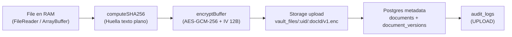
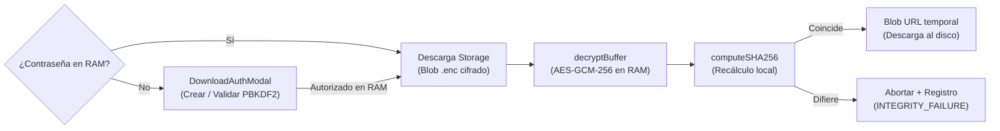

# Tech-Value Vault — Bóveda Documental Zero-Knowledge

> Bóveda documental B2B con arquitectura estricta de **Conocimiento Cero (Zero-Knowledge)** y sistema de diseño institucional **"Private Wealth"** para sectores de alta exigencia: **Banca Privada, Family Offices, LegalTech, FinTech y Salud**. Ni el operador del servidor, ni el proveedor cloud, ni un atacante con acceso total a la infraestructura pueden leer los documentos: el texto plano jamás abandona la memoria RAM del cliente sin cifrar.


**Índice**

1. [Visión ejecutiva](#1-visión-ejecutiva)
2. [El problema y el modelo de amenazas (Threat Model)](#2-el-problema-y-el-modelo-de-amenazas-threat-model)
3. [Especificación criptográfica](#3-especificación-criptográfica-srccryptovaultcryptots)
4. [Arquitectura de software (Feature-Driven)](#4-arquitectura-de-software-feature-driven)
5. [Sistema de diseño "Private Wealth"](#5-sistema-de-diseño-private-wealth)
6. [Arquitectura del backend (Supabase / PostgreSQL)](#6-arquitectura-del-backend-supabase--postgresql)
7. [Guía de instalación y despliegue local](#7-guía-de-instalación-y-despliegue-local)
8. [Operación segura, limitaciones conocidas y roadmap](#8-operación-segura-limitaciones-conocidas-y-roadmap)

---

## 1. Visión ejecutiva

**Tech-Value Vault** es una bóveda documental institucional donde el cifrado se realiza **íntegramente en el cliente**, antes de cualquier transmisión por red. El backend (Supabase: PostgreSQL + Storage + Auth) opera bajo el principio de **servidor ciego**: almacena únicamente blobs cifrados indistinguibles de ruido blanco, vectores de inicialización públicos y metadatos no sensibles (nombre, tamaño del texto plano, huella de integridad).

| Propiedad | Garantía |
|---|---|
| **Confidencialidad** | AES-GCM-256 con clave derivada localmente vía PBKDF2-SHA-256 (100.000 iteraciones). El servidor nunca recibe passphrase, clave ni texto plano |
| **Integridad** | Doble capa: tag de autenticación AES-GCM (128 bits) + verificación SHA-256 del texto plano tras descifrar en cliente |
| **Aislamiento multitenant** | Row Level Security (RLS) estricto por `auth.uid()` en todas las tablas y bucket privado particionado por usuario |
| **Custodia de claves** | `CryptoKey` no extraíble (`extractable: false`), exclusivamente en memoria RAM (Zustand, sin middleware persistente) |
| **Contraseña de descarga** | Compuerta de autorización por descarga: verificador PBKDF2-SHA-256 (100.000 iteraciones) en `profiles`, contraseña en claro sólo en RAM (`useDownloadAuthStore`) |
| **Acciones por archivo** | 3 acciones de alto valor: 1) **Descargar archivo** (sólido ébano gateado por contraseña en RAM), 2) **Visualizar** (modal centrado y accesible con metadatos y copiado de huella) y 3) **Eliminar** (modal destructivo irreversible con autorización en RAM) |
| **Búsqueda y filtros en RAM** | Filtrado instantáneo 100 % en memoria del cliente por texto/hash, versión (`v1` / `v2+`) y ordenamiento sin peticiones extra |
| **Sistema visual** | Estética **"Private Wealth"**: lienzo en porcelana cálida (`#F8F7F4`), cabecera en negro ébano (`#141413`), acentos en bronce topo (`#6E6053`) y tipografía editorial |
| **Recuperación soberana** | Frase mnemónica de 12 palabras (diccionario oficial BIP-39, 2048 palabras), generada con `crypto.getRandomValues` sin sesgo de módulo |
| **Trazabilidad** | Bitácora `audit_logs` con eventos `UPLOAD`, `DOWNLOAD_DECRYPT`, `DELETE` e `INTEGRITY_FAILURE` |
| **Cero dependencias cripto** | 100 % Web Crypto API nativa (`window.crypto.subtle`). Cero librerías externas para criptografía (sin crypto-js ni bcrypt) |

---

## 2. El problema y el modelo de amenazas (Threat Model)

### 2.1. Por qué las nubes tradicionales no bastan

En soluciones tradicionales de almacenamiento corporativo (Google Drive, OneDrive, AWS S3 SSE o Dropbox), **el proveedor retiene —directa o indirectamente— las claves de descifrado**:

- El cifrado "en reposo" lo aplica el servidor con claves que él mismo custodia (KMS del proveedor). Una orden judicial, un empleado desleal o una brecha con escalado de privilegios expone el contenido.
- El operador puede modificar políticas, rotar claves o acceder a snapshots sin conocimiento del cliente.
- Para un despacho jurídico, una entidad financiera o una firma de gestión patrimonial, esto incumple el principio de minimización de confianza exigido por RGPD, secreto bancario y normativas sectoriales (DORA, ENS, HIPAA).

### 2.2. Principio de Cero Confianza en el Servidor (Zero-Trust Backend)

Tech-Value Vault invierte el modelo: **el servidor es un disco duro ciego**.

- Supabase Storage (bucket privado `vault_files`) sólo recibe `ArrayBuffer` ya cifrados con AES-GCM-256, servidos como `application/octet-stream` con extensión `.enc`. Sin la clave, son indistinguibles de ruido blanco.
- PostgreSQL sólo guarda metadatos no sensibles: nombre de archivo, MIME, tamaño del texto plano, `storage_path`, IV (público por diseño en AES-GCM) y `sha256_hash` (sólo útil para verificar integridad *después* de descifrar, nunca para recuperar contenido).
- La autenticación (Supabase Auth, bcrypt en servidor) y la autorización (RLS) protegen el **acceso a los blobs**, pero incluso un atacante con `service_role`, con acceso físico a los discos o con un volcado completo de la base de datos **no puede descifrar ni un solo byte**: la clave sólo existe en la memoria RAM del navegador del usuario.

### 2.3. Actores y capacidades asumidas

| Atacante | Capacidad | Resultado esperado |
|---|---|---|
| **Curioso / empleado del proveedor** | Lectura total de Storage + Postgres | Obtiene ruido cifrado opaco. Sin clave: inútil |
| **Atacante de red (MITM)** | Interceptación TLS rota / CDN comprometido | Sólo ciphertext + metadatos públicos. La app exige contexto seguro (HTTPS) para Web Crypto |
| **Malware en el endpoint del usuario** | Lectura de RAM del navegador | Fuera de alcance: ningún software protege secretos en un endpoint comprometido; se mitiga con auto-bloqueo por inactividad (10 min) y destrucción inmediata de clave |
| **Usuario malicioso de otro tenant** | Llamadas autenticadas a la API | Bloqueado por RLS (`user_id = auth.uid()`) y rutas de Storage prefijadas por `{user_id}/` |
| **Manipulación del blob en servidor** | Sustitución o corrupción del `.enc` | Detectada: AES-GCM rechaza el tag de 128 bits y la verificación SHA-256 post-descifrado aborta la entrega, registrando `INTEGRITY_FAILURE` |

---

## 3. Especificación criptográfica (`src/core/crypto/vaultCrypto.ts`)

Todo el motor reside en un único módulo sin dependencias externas, basado exclusivamente en `window.crypto.subtle` y `window.crypto.getRandomValues`. Requiere **contexto seguro** (HTTPS o `localhost`).

### 3.1. Derivación de clave: PBKDF2-HMAC-SHA-256, 100.000 iteraciones

`deriveKey(passphrase, salt) → Promise<CryptoKey>`

1. La passphrase se importa como material base PBKDF2 (`importKey("raw", …, { name: "PBKDF2" }, false, ["deriveKey"])`).
2. Se deriva una clave simétrica `{ name: "AES-GCM", length: 256 }` con `iterations: 100_000` (recomendación OWASP) y hash `SHA-256`.
3. La `CryptoKey` resultante se crea con **`extractable: false`** y usos `["encrypt", "decrypt"]`: el material bruto de la clave no puede exportarse ni serializarse desde el proceso del navegador.

**Derivación del salt.** El salt PBKDF2 es determinista por usuario y se calcula en `deriveVaultSalt(userId)` como `SHA-256("tech-value:vault:kdf:v1:" + userId)`:
- Es único por cuenta (inmunidad frente a rainbow tables compartidas entre usuarios) y reproducible en cualquier dispositivo sin almacenar nada sensible.
- La etiqueta incluye dominio y versión (`tech-value:vault:kdf:v1`) para permitir migraciones futuras del KDF sin colisionar con claves existentes.

### 3.2. Cifrado simétrico autenticado: AES-GCM-256, IV de 12 bytes

`encryptBuffer(data, key) → { cipherBuffer, iv }` / `decryptBuffer(cipherBuffer, key, ivString)`

- Cada operación de cifrado genera un **IV aleatorio de 12 bytes (96 bits)** con `crypto.getRandomValues`, único por versión de documento, tal como exige la norma NIST SP 800-38D.
- El IV se serializa en hexadecimal y se almacena en claro en `document_versions.iv`. **El IV no es secreto** en AES-GCM: sólo garantiza unicidad.
- El descifrado valida la longitud del IV (12 bytes exactos) y delega en `subtle.decrypt`: si clave, IV o ciphertext no coinciden, la promesa se rechaza automáticamente mediante el **tag de autenticación de 128 bits** de GCM.

### 3.3. Integridad matemática: SHA-256 previo al cifrado

`computeSHA256(data) → hex` (minúsculas)

- En la subida se calcula el SHA-256 **del texto plano antes de cifrar** y se registra en `document_versions.sha256_hash` como referencia de integridad.
- En la descarga, tras descifrar en memoria RAM, se recalcula el hash del buffer resultante y se compara en tiempo constante. Cualquier discrepancia aborta la entrega al usuario y emite un evento `INTEGRITY_FAILURE` en auditoría.

### 3.4. Ciclo de vida de la clave en memoria RAM

```
Registro / Login
  → PBKDF2 local → CryptoKey (extractable: false)
    → useAuthStore.vaultKey (RAM, sin middleware persist)
      → uso en uploadDocument / downloadAndDecrypt (pasada por parámetro)
        → Inactividad (10 min) / signOut / F5 → null (destrucción inmediata)
```

- El store **no usa `persist` de Zustand**; la clave no extraíble jamás toca `localStorage`, cookies ni IndexedDB.
- `signOut()` destruye la clave **antes** de la llamada de red.
- Temporizador de inactividad de 10 minutos en `App.tsx` que purga automáticamente la clave y la contraseña de descarga si no hay interacción del usuario.

### 3.5. Recuperación soberana: 12 palabras BIP-39 sin sesgo de módulo

`generateRecoveryPhrase() → string`

- En el registro se genera una frase de **12 palabras** del **diccionario oficial BIP-39 (2048 palabras)** embebido en el módulo.
- Aleatoriedad provista por `crypto.getRandomValues` sobre `Uint16Array(12)`; al ser 2048 = 2¹¹, cada valor de 16 bits se enmascara a 11 bits (`& 0x07FF`), eliminando cualquier sesgo de módulo.
- La frase vive **sólo en RAM**, se muestra una única vez en el modal institucional y se purga tras confirmación.

### 3.6. Contraseña de descarga: verificador PBKDF2-SHA-256 + secreto sólo en RAM

`generateDownloadSaltHex()` / `deriveDownloadVerifier(password, saltHex)` / `timingSafeEqualHex(a, b)`:

- **Creación:** Salt aleatorio de 32 bytes (64 caracteres hex) + `PBKDF2-SHA-256, 100.000 iteraciones, 256 bits` vía `subtle.deriveBits`. Se persisten en `profiles.download_salt` y `profiles.download_verifier`.
- **Verificación:** Derivación del candidato y comparación en tiempo constante (`timingSafeEqualHex`) para mitigar ataques de temporización.
- **Custodia:** La contraseña validada vive únicamente en `useDownloadAuthStore.downloadSessionPassword` en RAM durante la pestaña activa.

---

## 4. Arquitectura de software (Feature-Driven)

### 4.1. Árbol de directorios

```
src/
├── main.tsx                      # Entrypoint: StrictMode + App
├── index.css                     # Directivas Tailwind + capa base Private Wealth (.font-editorial)
├── vite-env.d.ts                 # Tipado de VITE_SUPABASE_URL / VITE_SUPABASE_ANON_KEY
├── App.tsx                       # Orquestador: timeout inactividad + compuerta de estados
├── app/                          # Layout y proveedores base
├── assets/                       # Recursos estáticos
│
├── core/crypto/
│   └── vaultCrypto.ts            # Motor Zero-Knowledge puro: PBKDF2, AES-GCM-256,
│                                 # SHA-256, BIP-39, comparador timing-safe, utilidades hex
│
├── features/auth/
│   ├── components/
│   │   └── AuthCard.tsx          # Login, Registro, Verificación OTP y Frase BIP-39 (Private Wealth)
│   └── stores/
│       └── useAuthStore.ts       # Sesión Supabase + vaultKey en RAM + recoveryPhrase efímera
│
├── features/vault/
│   ├── components/
│   │   ├── VaultDashboard.tsx    # Header ébano, catálogo porcelana, 3 filtros en RAM y métricas
│   │   ├── DocumentRow.tsx       # Fila Private Wealth: micro-sello, pill bronce topo, 3 acciones
│   │   ├── FileUploadModal.tsx   # Modal drag & drop con visualizador de Pipeline ZK
│   │   ├── DocumentPreviewModal.tsx # Modal centrado en portal: metadatos y copiado de huella SHA-256
│   │   ├── DownloadAuthModal.tsx # Compuerta de autorización para contraseña de descarga en RAM
│   │   └── DeleteDocumentModal.tsx  # Confirmación destructiva con autorización en RAM
│   ├── stores/
│   │   ├── useVaultStore.ts      # Catálogo + subida/descifrado + bitácora audit_logs
│   │   └── useDownloadAuthStore.ts # Contraseña de descarga en RAM (sin persist)
│   └── utils/
│       └── formatters.ts         # Formateadores institucionales (tamaño, fechas, hashes)
│
└── shared/
    ├── lib/supabase.ts           # Cliente tipado createClient<Database>
    └── types/
        ├── database.ts           # Esquema relacional de Supabase (PostgreSQL)
        └── index.ts              # Tipos de dominio: VaultDocument, UploadStatus, AuditAction
```

### 4.2. Flujo de datos: Subida Cifrada



1. **Lectura local**: Carga directa del archivo en memoria RAM del navegador.
2. **Huella criptográfica**: Cálculo SHA-256 del texto plano como sello de integridad.
3. **Cifrado autenticado**: Cifrado local con la `vaultKey` AES-GCM e IV único por versión.
4. **Almacenamiento ciego**: Transmisión a Supabase Storage con extensión `.enc` y tipo `application/octet-stream`.
5. **Registro de versión**: Escritura atómica de metadatos no sensibles (`iv`, `sha256_hash`, `file_size`).
6. **Compensación ante fallos**: Rollback automático en Storage si el registro relacional falla.

### 4.3. Flujo de datos: Descarga con Compuerta de Autorización



---

## 5. Sistema de diseño "Private Wealth"

La interfaz de usuario implementa el sistema de diseño **"Private Wealth"**, inspirado en la sobriedad, legibilidad y refinamiento de la banca privada internacional (Ginebra / Zúrich), combinando un 90 % de superficies claras de porcelana con acentos profundos en negro ébano y bronce topo.

### 5.1. Paleta de colores y tokens visuales

| Elemento | Token / Hex | Clase Tailwind | Uso principal |
|---|---|---|---|
| **Lienzo principal (Fondo)** | `#F8F7F4` | `bg-[#F8F7F4]` | Fondo global de la aplicación (porcelana cálida) |
| **Barra superior (Header)** | `#141413` | `bg-[#141413] border-b border-[#262523]` | Header institucional permanente en negro ébano |
| **Tarjetas y Modales** | `#FFFFFF` | `bg-white border border-[#E6E4DD]` | Tarjetas de contenido, paneles de filtros y modales |
| **Cabecera de tablas** | `#F5F4EF` | `bg-[#F5F4EF] text-[#6E6A63]` | Fila superior `<thead>` con tipografía de bajo impacto |
| **Botón Primario (CTA)** | `#141413` | `bg-[#141413] hover:bg-[#2B2A27]` | Acciones de mayor jerarquía (+ Proteger documento, Confirmar) |
| **Pill Bronce Topo sólido** | `#6E6053` | `bg-[#6E6053] text-white` | Insignias de versión (`v1`, `v2+`), sello Zero-Knowledge y RAM |
| **Insignia Bronce suave** | `#F5F2EB` | `bg-[#F5F2EB] border-[#D8D0C5] text-[#5C5043]` | Contenedores de iconos, avisos de seguridad y tooltips |
| **Texto de alto contraste** | `#181816` | `text-[#181816]` | Títulos, nombres de archivo y valores principales |
| **Texto secundario** | `#6E6A63` | `text-[#6E6A63]` | Subtítulos, etiquetas, fechas y metadatos |
| **Alerta destructiva** | `#DC2626` | `bg-red-50 border-red-200 text-red-900` | Alertas de eliminación y fallos criptográficos |

### 5.2. Pila tipográfica

- **Títulos y Marca:** Tipografía editorial serif (`Newsreader`, Georgia, `'Times New Roman'`, serif) mediante la clase `.font-editorial` con tracking ajustado (`letter-spacing: -0.02em`).
- **Interfaz y lectura general:** `Plus Jakarta Sans` y `Inter`, proporcionando alta legibilidad y nitidez en pantallas de alta densidad.
- **Material criptográfico:** `JetBrains Mono` para huellas SHA-256, vectores IV, códigos OTP de 6 dígitos y frases BIP-39.

### 5.3. Búsqueda y Filtros instantáneos en RAM

En `VaultDashboard.tsx`, los documentos custodiados se filtran y ordenan directamente en memoria RAM sin disparar consultas adicionales:

1. **Buscador predictivo**: Coincidencia insensible a mayúsculas sobre el nombre del documento o la huella SHA-256.
2. **Filtro de versión**:
   - `all`: Todas las versiones registradas.
   - `v1`: Versión original o inicial del archivo.
   - `multi`: Archivos con múltiples versiones registradas (`v2+`).
3. **Selector de orden**:
   - `newest`: Orden cronológico inverso (más recientes primero).
   - `largest`: Mayor tamaño de texto plano primero.
   - `name`: Orden alfabético (A-Z).

### 5.4. Arquitectura de Modales Accesibles (Portales)

Todos los modales se renderizan en el `document.body` mediante `createPortal`, evitando cualquier recorte por scrollbars en tablas:

- **FileUploadModal**: Pipeline visual reactivo de 4 pasos con porcentajes e iconos dinámicos.
- **DocumentPreviewModal**: Cuadrícula de metadatos, visualización de huella completa y botón con feedback de copiado al portapapeles.
- **DownloadAuthModal**: Verificación PBKDF2 para almacenar la contraseña temporal en RAM.
- **DeleteDocumentModal**: Flujo destructivo con validación de seguridad integrada.

---

## 6. Arquitectura del backend (Supabase / PostgreSQL)

Esquema `public` auditado y tipado en `src/shared/types/database.ts`:

### 6.1. Tablas relacionales

- **`profiles`**: Almacena el identificador `id uuid` (`auth.users.id`), `email`, y las columnas criptográficas de autorización:
  - `download_verifier text`: Hash derivado PBKDF2-SHA-256 (100.000 iteraciones) de la contraseña de descarga.
  - `download_salt text`: Salt criptográfico aleatorio de 32 bytes (hex).
- **`documents`**: Cabecera lógica de documentos vinculada a `user_id uuid`.
- **`document_versions`**: Versiones inmutables con `iv` (12 bytes hex), `sha256_hash` (hex del texto plano) y `storage_path`.
- **`audit_logs`**: Registro inmutable de eventos (`UPLOAD`, `DOWNLOAD_DECRYPT`, `DELETE`, `INTEGRITY_FAILURE`).

### 6.2. Row Level Security (RLS)

Políticas de seguridad a nivel de fila obligatorias:

```sql
alter table profiles          enable row level security;
alter table documents         enable row level security;
alter table document_versions enable row level security;
alter table audit_logs        enable row level security;

-- Aislamiento estricto por auth.uid()
create policy "profiles_owner"
  on profiles for all using (id = auth.uid()) with check (id = auth.uid());

create policy "documents_owner"
  on documents for all using (user_id = auth.uid()) with check (user_id = auth.uid());

create policy "versions_owner_select"
  on document_versions for select using (
    exists (select 1 from documents d where d.id = document_versions.document_id and d.user_id = auth.uid())
  );

create policy "versions_owner_write"
  on document_versions for insert with check (
    exists (select 1 from documents d where d.id = document_versions.document_id and d.user_id = auth.uid())
  );

create policy "audit_owner_insert"
  on audit_logs for insert with check (user_id = auth.uid());

create policy "audit_owner_select"
  on audit_logs for select using (user_id = auth.uid());
```

---

## 7. Guía de instalación y despliegue local

### 7.1. Requisitos

- **Node.js 20 LTS o 22+**
- **pnpm 9+**
- Proyecto Supabase configurado con el bucket privado `vault_files`.

### 7.2. Puesta en marcha

```bash
# 1. Clonar el repositorio
git clone <url-del-repo> tech-value
cd tech-value

# 2. Instalar dependencias exactas
pnpm install

# 3. Configurar variables de entorno
cp .env.example .env.local # O crear .env.local
```

Configuración en `.env.local`:

```bash
VITE_SUPABASE_URL=https://tu-proyecto.supabase.co
VITE_SUPABASE_ANON_KEY=tu-anon-key-publica
```

### 7.3. Comandos de desarrollo y auditoría

| Comando | Descripción |
|---|---|
| `pnpm run dev` | Inicia el servidor de desarrollo Vite con HMR |
| `pnpm run lint` | Ejecuta `oxlint` (validación de TypeScript y reglas de React) |
| `pnpm run build` | Compilación estricta con `tsc -b` y empaquetado optimizado en `dist/` |
| `pnpm run preview` | Sirve localmente la compilación de producción para validación |

---

## 8. Operación segura, limitaciones conocidas y roadmap

### 8.1. Buenas prácticas operativas

- **Contexto seguro obligatorio**: Servir bajo HTTPS en entornos de producción para habilitar `window.crypto.subtle`.
- **Inactividad**: La aplicación expira automáticamente la clave en RAM a los 10 minutos de inactividad del cursor o teclado.
- **Sin huella persistente**: Al cerrar sesión o recargar con F5, la memoria RAM es liberada y la clave de cifrado se destruye por completo.

### 8.2. Roadmap y evolución

1. **Rotación soberana de claves**: Re-cifrado en lote de versiones mediante derivación progresiva sin exposición en servidor.
2. **Historial de versiones completas**: Interfaz para restaurar versiones intermedias (`v1`, `v2`, `v3`) directamente en el modal de previsualización.
3. **Modo Solo Depósito**: Capacidad de recepción documental para terceros sin privilegios de lectura o eliminación.
4. **Triggers PostgreSQL**: Auditoría formal irrevocable mediante triggers automáticos en la base de datos.
