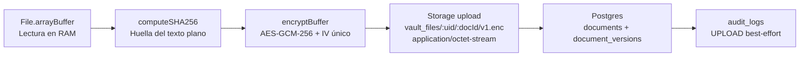
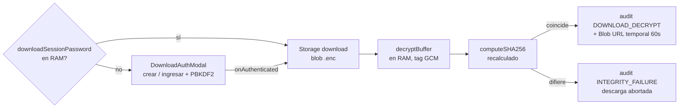

# Tech-Value Vault — Bóveda Documental Zero-Knowledge

> Bóveda documental B2B con arquitectura estricta de **Conocimiento Cero (Zero-Knowledge)** para sectores regulados: **LegalTech, FinTech y Salud**. Ni el operador del servidor, ni el proveedor cloud, ni un atacante con acceso total a la base de datos pueden leer el contenido de los documentos: el texto plano jamás abandona el navegador del cliente sin cifrar.


**Índice**

1. [Visión ejecutiva](#1-visión-ejecutiva)
2. [El problema y el modelo de amenazas](#2-el-problema-y-el-modelo-de-amenazas-threat-model)
3. [Especificación criptográfica](#3-especificación-criptográfica-src corecryptovaultcryptots)
4. [Arquitectura de software (Feature-Driven)](#4-arquitectura-de-software-feature-driven)
5. [Arquitectura del backend (Supabase / PostgreSQL)](#5-arquitectura-del-backend-supabase--postgresql)
6. [Guía de instalación y despliegue local](#6-guía-de-instalación-y-despliegue-local)
7. [Operación segura, limitaciones conocidas y roadmap](#7-operación-segura-limitaciones-conocidas-y-roadmap)

---

## 1. Visión ejecutiva

**Tech-Value Vault** es una bóveda documental corporativa donde el cifrado se realiza **íntegramente en el cliente**, antes de cualquier transmisión por red. El backend (Supabase: PostgreSQL + Storage + Auth) opera bajo el principio de **servidor ciego**: almacena únicamente blobs cifrados indistinguibles de ruido blanco, vectores de inicialización públicos y metadatos no sensibles (nombre, tamaño del texto plano, huella de integridad).

| Propiedad | Garantía |
|---|---|
| Confidencialidad | AES-GCM-256 con clave derivada localmente vía PBKDF2-SHA-256 (100.000 iteraciones). El servidor nunca recibe passphrase, clave ni texto plano |
| Integridad | Doble capa: tag de autenticación AES-GCM + verificación SHA-256 del texto plano tras descifrar |
| Aislamiento multitenant | Row Level Security (RLS) estricto por `auth.uid()` en todas las tablas y bucket privado por usuario |
| Custodia de claves | `CryptoKey` no extraíble (`extractable: false`), exclusivamente en memoria RAM (Zustand, sin persistencia) |
| Contraseña de descarga | Compuerta de autorización por descarga: verificador PBKDF2-SHA-256 (100.000 iteraciones) en `profiles`, contraseña en claro sólo en RAM (`useDownloadAuthStore`, sin `persist`) |
| Acciones por archivo | Exactamente 2: 1) "Descargar archivo" (gateada por la contraseña en RAM) y 2) "Visualizar" (hover/popover con tipo, SHA-256 completa, tamaño y fecha de custodia) |
| Recuperación soberana | Frase mnemónica de 12 palabras (diccionario oficial BIP-39, 2048 palabras), generada con `crypto.getRandomValues` sin sesgo de módulo |
| Trazabilidad | Bitácora `audit_logs` con eventos `UPLOAD`, `DOWNLOAD_DECRYPT` e `INTEGRITY_FAILURE` |
| Cero dependencias cripto | 100 % Web Crypto API nativa. Prohibido `crypto-js`, `bcrypt` y cualquier librería de terceros para criptografía (ver `CLAUDE.MD`) |

---

## 2. El problema y el modelo de amenazas (Threat Model)

### 2.1. Por qué las nubes tradicionales no bastan

En soluciones como Google Drive, OneDrive, AWS S3 con SSE o Dropbox, **el proveedor retiene —directa o indirectamente— las claves de descifrado**:

- El cifrado "en reposo" lo aplica el servidor con claves que él mismo custodia (KMS del proveedor). Una orden judicial, un empleado desleal o una brecha con escalado de privilegios expone el contenido.
- El operador puede modificar políticas, rotar claves o acceder a snapshots sin conocimiento del cliente.
- Para un despacho jurídico, una entidad financiera o un hospital, esto incumple el principio de minimización de confianza exigido por RGPD, secreto profesional y normativas sectoriales (DORA, ENS, HIPAA como marcos de referencia).

### 2.2. Principio de Cero Confianza en el Servidor (Zero-Trust Backend)

Tech-Value Vault invierte el modelo: **el servidor es un disco duro ciego**.

- Supabase Storage (bucket privado `vault_files`) sólo recibe `ArrayBuffer` ya cifrados con AES-GCM-256, servidos como `application/octet-stream` con extensión `.enc`. Sin la clave, son indistinguibles de ruido blanco.
- PostgreSQL sólo guarda metadatos no sensibles: nombre de archivo, MIME, tamaño del texto plano, `storage_path`, IV (público por diseño en AES-GCM) y `sha256_hash` (sólo útil para verificar integridad *después* de descifrar, nunca para recuperar contenido).
- La autenticación (Supabase Auth, bcrypt en servidor) y la autorización (RLS) protegen el **acceso a los blobs**, pero incluso un atacante con `service_role`, con acceso físico a los discos o con un volcado completo de la base de datos **no puede descifrar ni un solo byte**: la clave sólo existe en la RAM del navegador del propietario.

### 2.3. Actores y capacidades asumidas

| Atacante | Capacidad | Resultado esperado |
|---|---|---|
| Curioso / empleado del proveedor | Lectura total de Storage + Postgres | Obtiene ruido cifrado. Sin clave: inútil |
| Atacante de red (MITM) | Interceptación TLS rota / CDN comprometido | Sólo ciphertext + metadatos públicos. La app exige contexto seguro (HTTPS) para Web Crypto |
| Malware en el endpoint del usuario | Lectura de RAM del navegador | Fuera de alcance: ningún software protege secretos en un endpoint comprometido; se mitiga con sesiones cortas y cierre de sesión que destruye la clave |
| Usuario malicioso de otro tenant | Llamadas autenticadas a la API | Bloqueado por RLS (`user_id = auth.uid()`) y rutas de Storage prefijadas por `{user_id}/` |
| Manipulación del blob en servidor | Sustitución/corrupción del `.enc` | Detectada: AES-GCM rechaza el tag y la verificación SHA-256 post-descifrado aborta la entrega, registrando `INTEGRITY_FAILURE` |

**Explícitamente fuera de alcance:** seguridad del endpoint del cliente, denegación de servicio y borrado destructivo por parte del operador (disponibilidad, no confidencialidad).

---

## 3. Especificación criptográfica (`src/core/crypto/vaultCrypto.ts`)

Todo el motor reside en un único módulo sin dependencias externas, basado exclusivamente en `window.crypto.subtle` y `window.crypto.getRandomValues`. Requiere **contexto seguro** (HTTPS o `localhost`).

### 3.1. Derivación de clave: PBKDF2-HMAC-SHA-256, 100.000 iteraciones

`deriveKey(passphrase, salt) → Promise<CryptoKey>`

1. La passphrase se importa como material base PBKDF2 (`importKey("raw", …, { name: "PBKDF2" }, false, ["deriveKey"])`).
2. Se deriva una clave simétrica `{ name: "AES-GCM", length: 256 }` con `iterations: 100_000` (mínimo recomendado por OWASP) y hash `SHA-256`.
3. La `CryptoKey` resultante se crea con **`extractable: false`** y usos `["encrypt", "decrypt"]`: el material bruto de la clave no puede exportarse ni siquiera desde el propio proceso del navegador.

**Derivación del salt.** El salt PBKDF2 es determinista por usuario y se calcula en `deriveVaultSalt(userId)` (`src/features/auth/stores/useAuthStore.ts`) como `SHA-256("tech-value:vault:kdf:v1:" + userId)`:

- Es único por cuenta (inmunidad frente a rainbow tables compartidas entre usuarios) y reproducible en cualquier dispositivo sin almacenar nada, ya que el esquema actual de `profiles` no dispone de columna para un salt aleatorio.
- Los salts no son secretos por definición; su función es impedir precomputación masiva, no custodiar confidencialidad.
- La etiqueta incluye dominio y versión (`tech-value:vault:kdf:v1`) para permitir migraciones futuras del KDF sin colisionar con claves existentes.
- > **Mejora recomendada (roadmap):** añadir `profiles.vault_salt text NOT NULL` con 32 bytes aleatorios generados en el registro y leerlo en lugar de derivarlo. Ver [sección 7](#7-operación-segura-limitaciones-conocidas-y-roadmap).

La misma passphrase cumple dos funciones independientes: (a) autenticarse contra Supabase Auth —el servidor sólo ve su bcrypt— y (b) derivar localmente la clave de bóveda. **La passphrase verificada se usa para re-derivar la clave al desbloquear** (`unlockVaultWithPassword` la valida primero contra Supabase Auth, porque PBKDF2 nunca "falla" ante una contraseña errónea: produciría silenciosamente una clave incorrecta capaz de corromper futuras subidas).

### 3.2. Cifrado simétrico autenticado: AES-GCM-256, IV de 12 bytes

`encryptBuffer(data, key) → { cipherBuffer, iv }` / `decryptBuffer(cipherBuffer, key, ivString)`

- Cada operación de cifrado genera un **IV aleatorio de 12 bytes (96 bits)** con `crypto.getRandomValues`, único por versión de documento, tal como exige AES-GCM. Reutilizar un IV con la misma clave sería catastrófico; aquí es imposible por construcción.
- El IV se serializa en hexadecimal y se almacena en claro en `document_versions.iv`. **El IV no es secreto** en AES-GCM: sólo garantiza unicidad.
- El descifrado valida la longitud del IV (12 bytes exactos) y delega en `subtle.decrypt`: si clave, IV o ciphertext no cuadran, la promesa se rechaza automáticamente gracias al **tag de autenticación de 128 bits** de GCM (primera capa de integridad).
- Utilidades de serialización segura sin dependencias: `bufferToHex` / `hexToBuffer` (con validación estricta de formato), `bufferToBase64` / `base64ToBuffer` (por bloques de 32 KB para no desbordar la pila en archivos grandes).

### 3.3. Integridad matemática: SHA-256 previo al cifrado

`computeSHA256(data) → hex` (minúsculas)

- En la subida se calcula el SHA-256 **del texto plano antes de cifrar** y se registra en `document_versions.sha256_hash` como referencia de integridad.
- En la descarga, tras descifrar en RAM, se recalcula el hash y se compara con el registrado. Cualquier discrepancia —corrupción de disco, manipulación del blob, defectos de almacenamiento— **aborta la entrega al usuario** y escribe un evento `INTEGRITY_FAILURE` en la auditoría (segunda capa de integridad, defensa en profundidad sobre el tag GCM).

### 3.4. Ciclo de vida de la clave en memoria RAM

```
Registro / Login / Desbloqueo
  → PBKDF2 local → CryptoKey (extractable: false)
    → useAuthStore.vaultKey (RAM, sin middleware persist)
      → uso en uploadDocument / downloadAndDecrypt (se pasa por parámetro;
         useVaultStore JAMÁS la almacena: la clave vive en un único lugar)
        → signOut / SIGNED_OUT / recarga → null (destrucción inmediata)
```

- El store **no usa `persist` de Zustand**; la clave es no extraíble, por lo que ni siquiera *podría* serializarse a `localStorage`.
- `signOut()` destruye la clave **antes** de la llamada de red, minimizando la ventana de exposición.
- `initSession()` restaura la sesión de Supabase (sólo tokens, persistidos por el SDK), pero **nunca** la clave: tras recargar, la UI exige desbloquear de nuevo con la passphrase.
- En `localStorage` sólo viven los tokens de Supabase Auth (`persistSession: true`); robarlos permite descargar blobs, pero **siguen siendo ruido cifrado** sin la clave de bóveda.

### 3.5. Recuperación soberana: 12 palabras BIP-39 sin sesgo de módulo

`generateRecoveryPhrase() → string`

- En el registro se genera una frase de **12 palabras** del **diccionario oficial BIP-39 en inglés (2048 palabras)**, embebido en el módulo (fuente: `bitcoin/bips`).
- Aleatoriedad de `crypto.getRandomValues` sobre `Uint16Array(12)`; como 2048 = 2¹¹, cada valor de 16 bits se enmascara a 11 bits (`& 0x07FF`). Dado que 65536 / 2048 = 32 exactamente, esta reducción **no introduce sesgo de módulo**: cada palabra tiene probabilidad idéntica.
- Es intencionalmente síncrona (no necesita `subtle`) y genera cada palabra de forma independiente: aquí actúa como **secreto de recuperación de bóveda**, no como semilla determinista de wallet, por lo que no se deriva entropía con checksum BIP-39 completo.
- La frase vive **sólo en RAM** (`recoveryPhrase`), se muestra una única vez con advertencia explícita ("el servidor no puede recuperarla") y debe limpiarse con `clearRecoveryPhrase()` en cuanto la UI termina de mostrarla. No existe columna para ella en base de datos, por diseño.

### 3.6. Contraseña de descarga: verificador PBKDF2-SHA-256 + secreto sólo en RAM

> Añadido en la iteración "Contraseña de Descarga en Memoria RAM". Es una **compuerta de autorización** independiente de la `vaultKey`: el descifrado sigue usando AES-GCM-256; la contraseña de descarga sólo decide *si* se ejecuta la descarga.

`generateDownloadSaltHex() → hex` / `deriveDownloadVerifier(password, saltHex) → hex` / `timingSafeEqualHex(a, b)` (en `vaultCrypto.ts`):

- **Creación:** salt aleatorio de 32 bytes (`crypto.getRandomValues`, 64 chars hex) + `PBKDF2-SHA-256, 100.000 iteraciones, 256 bits` vía `subtle.deriveBits` (no `deriveKey`: aquí sí se necesita comparar el material derivado). Se persisten **sólo** `profiles.download_salt` y `profiles.download_verifier` (ambos hex públicos por diseño; el salt no es secreto, el verificador no permite recuperar la contraseña).
- **Verificación:** se re-deriva con el salt guardado y se compara con el verificador en **tiempo constante** (`timingSafeEqualHex`) para no filtrar por timing la posición del primer byte distinto.
- **Custodia:** la contraseña en claro vive **únicamente** en `useDownloadAuthStore.downloadSessionPassword` (Zustand **sin** middleware `persist`: jamás toca `localStorage`, `sessionStorage`, cookies ni IndexedDB). Al recargar la pestaña vuelve a `null` automáticamente (el módulo se re-evalúa); al cerrar sesión el dashboard la destruye con `clearDownloadSessionPassword()` antes de la llamada de red, igual que la `vaultKey`.
- A diferencia del salt determinista de la `vaultKey` (derivado del `userId` por limitación del esquema original), este salt **sí es aleatorio por usuario** y migra el diseño hacia el objetivo del roadmap (`profiles.vault_salt`).

---

## 4. Arquitectura de software (Feature-Driven)

### 4.1. Árbol de directorios

```
src/
├── main.tsx                      # Entrypoint: StrictMode + App
├── index.css                     # Sólo directivas Tailwind (base/components/utilities)
├── vite-env.d.ts                 # Tipado de VITE_SUPABASE_URL / VITE_SUPABASE_ANON_KEY
├── App.tsx                       # Puerta de estados: initSession → AuthCard | Unlock | Dashboard
├── app/                          # (reservado) router, providers y layout raíz
├── assets/                       # Estáticos del template Vite
│
├── core/crypto/
│   └── vaultCrypto.ts            # Motor Zero-Knowledge: PBKDF2, AES-GCM-256,
│                                 # SHA-256, frase BIP-39, utilidades hex/base64
│
├── features/auth/
│   ├── components/AuthCard.tsx   # Login/registro con pestañas + modal de frase de recuperación
│   └── stores/useAuthStore.ts    # Sesión Supabase + vaultKey en RAM + recoveryPhrase efímera
│
├── features/vault/
│   ├── components/
│   │   ├── VaultDashboard.tsx    # Header corporativo + tabla + flujo de descarga gateado
│   │   │                         # (con contraseña en RAM → directa; sin ella → modal)
│   │   ├── DocumentRow.tsx       # Fila con EXACTAMENTE 2 acciones: Descargar archivo +
│   │   │                         # Visualizar (hover/popover: tipo, SHA-256 completa,
│   │   │                         # tamaño, fecha de custodia). Sin botón copiar-hash.
│   │   ├── DownloadAuthModal.tsx # Crear / Ingresar contraseña de descarga (ver 3.6):
│   │   │                         # consulta profiles, PBKDF2, guarda en RAM, onAuthenticated
│   │   └── FileUploadModal.tsx   # Drag & Drop + pipeline visual reading→hashing→
│   │                             # encrypting→uploading→done
│   └── stores/
│       ├── useVaultStore.ts          # Catálogo + pipeline subir/descifrar + auditoría best-effort
│       └── useDownloadAuthStore.ts   # downloadSessionPassword SÓLO en RAM, sin persist
│
├── features/audit/               # (reservado) UI de auditoría; el registro lo emite useVaultStore
│
└── shared/
    ├── lib/supabase.ts           # Cliente tipado createClient<Database>; falla sin env vars
    └── types/
        ├── database.ts           # Contrato del esquema public + VAULT_BUCKET = 'vault_files'
        └── index.ts              # VaultDocument, VaultVersionDescriptor, UploadStatus, AuditAction
```

| Módulo | Responsabilidad | Lo que nunca hace |
|---|---|---|
| `core/crypto` | Primitivas puras, testeables, sin I/O ni estado | Tocar red, DOM o stores |
| `features/auth` | Identidad + custodia en RAM de `vaultKey` y `recoveryPhrase` | Persistir la clave; almacenarla fuera de RAM |
| `features/vault` | Orquestar el pipeline cifrado y el catálogo; recibir la clave **por parámetro** | Almacenar la `vaultKey` (vive en un único lugar) |
| `shared` | Cliente Supabase tipado y tipos de dominio derivados del esquema real | Contener lógica de negocio |

La UI (`src/App.tsx`) implementa una máquina de tres estados: sin `user` → `AuthCard`; con sesión pero sin `vaultKey` → diálogo de desbloqueo (`unlockVaultWithPassword`); con ambas → `VaultDashboard`. Durante la hidratación inicial se muestra un splash para evitar parpadeos.

### 4.2. Flujo de datos: subida



Paso a paso (`uploadDocument(file, vaultKey)` en `useVaultStore.ts`):

1. **Lectura** (`uploadStatus: 'reading'`): `file.arrayBuffer()` en memoria; el texto plano nunca toca disco ni red.
2. **Huella** (`'hashing'`): `computeSHA256` del texto plano → referencia de integridad.
3. **Cifrado** (`'encrypting'`): `encryptBuffer` con la `vaultKey` de RAM e IV aleatorio por versión.
4. **Transmisión** (`'uploading'`): subida del ciphertext a `{user_id}/{document_id}/v1.enc`. El `documentId` (`crypto.randomUUID()`) se genera en cliente para construir la ruta antes de que exista la fila.
5. **Registro transaccional**: `insert` en `documents` + `document_versions` (con `iv`, `sha256_hash` y `file_size` del texto plano). Si falla el registro de versión, se elimina la fila de documento huérfana; si falla tras subir el blob, se ejecuta **rollback del objeto en Storage** para no dejar blobs huérfanos.
6. **Auditoría no bloqueante** (`UPLOAD` con tamaños plano/cifrado, hash y ruta): un fallo aquí sólo se registra en consola; jamás invalida una operación criptográfica ya consolidada.
7. `uploadStatus: 'done'` y refresco del catálogo vía `fetchDocuments()`.

### 4.3. Flujo de datos: descarga (gateada por la contraseña en RAM)



Paso a paso (`VaultDashboard.handleDownload` + `downloadAndDecrypt(descriptor, vaultKey)`):

1. **Compuerta de autorización:** si `useDownloadAuthStore.downloadSessionPassword` está en RAM, se procede directo; si es `null`, se encola el documento (`pendingDoc`) y se abre `DownloadAuthModal`. Tras `onAuthenticated`, se ejecuta la descarga del archivo encolado.
2. Descarga del blob cifrado desde `versionData.storagePath`.
3. Descifrado en RAM; AES-GCM rechaza automáticamente claves incorrectas o ciphertext alterado.
4. Verificación SHA-256 contra `document_versions.sha256_hash`. Ante discrepancia: evento `INTEGRITY_FAILURE` y error explícito al usuario.
5. Evento `DOWNLOAD_DECRYPT` y entrega al disco mediante `<a download>` con object URL revocada a los 60 s (`OBJECT_URL_TTL_MS`), para no abortar la descarga ni filtrar URLs persistentes.

> La contraseña de descarga **no descifra**: sólo autoriza. El descifrado usa siempre la `vaultKey` AES-GCM de `useAuthStore`.

### 4.4. Acciones por archivo: exactamente 2 (sin redundancias)

`DocumentRow.tsx` expone **únicamente** estas dos opciones en la columna de acciones (el antiguo botón de copiar hash se eliminó; la huella completa vive en el popover):

| # | Acción | Disparador | Efecto |
|---|---|---|---|
| 1 | **Descargar archivo** | Botón con icono `Download` | Ejecuta el flujo gateado de [4.3](#43-flujo-de-datos-descarga-gateada-por-la-contraseña-en-ram) |
| 2 | **Visualizar** | Hover sobre el botón `Eye` **o** sobre el nombre del archivo → tooltip/popover flotante | Cuadro con previsualización de metadatos: tipo de archivo (MIME), huella SHA-256 **completa**, tamaño y fecha de custodia (+ versión). El contenido en claro nunca se expone sin descargar + descifrar en RAM |

### 4.5. Endurecimiento propuesto: modo Solo Depósito (roadmap)

> **Estado: propuesta de diseño, no implementado.** El catálogo actual permite a cada propietario subir y descargar sus propios documentos. Para escenarios de custodia receptora (p. ej. un notario que recibe pruebas de clientes sin que estos puedan leer ni borrar lo ajeno), el diseño prevé un **modo Solo Depósito**: otorgar a un rol/sesión básica permiso de `INSERT` en `documents`/`document_versions` y de subida al prefijo de Storage correspondiente, **denegando** `SELECT` sobre versiones ajenas, `DOWNLOAD` de blobs y `DELETE`. Se implementa íntegramente con políticas RLS y de Storage (sin cambios de cliente), siguiendo el patrón de la [sección 5.3](#53-row-level-security-referencia). Consta como trabajo futuro en la [sección 7](#7-operación-segura-limitaciones-conocidas-y-roadmap).

---

## 5. Arquitectura del backend (Supabase / PostgreSQL)

Esquema `public` real, verificado contra el proyecto Supabase y tipado en `src/shared/types/database.ts` (inyectado en `createClient<Database>()`: columnas o tipos incorrectos fallan en compilación).

### 5.1. Tablas

**`profiles`** — identidad pública mínima. `id uuid PK` (= `auth.users.id`), `email text`, `created_at timestamptz`, más **`download_verifier text NULL`** (hex PBKDF2-SHA-256 de la contraseña de descarga) y **`download_salt text NULL`** (salt aleatorio hex). Se crea por `upsert` idempotente en `signUp`/`signIn`; el verificador se escribe después vía `update` desde `DownloadAuthModal` (política `profiles_owner` ya lo permite al ser el dueño). Jamás contiene passphrases, claves ni texto plano: sólo el verificador y el salt, inútiles sin la contraseña.

```sql
-- Migración requerida para la contraseña de descarga:
alter table profiles
  add column if not exists download_verifier text,
  add column if not exists download_salt text;
```

**`documents`** — documento lógico (cabecera). `id uuid PK` (generado en cliente), `user_id uuid`, `name text`, `mime_type text` (tipo real para la descarga; el blob viaja como opaco), `created_at` / `updated_at`. Listado ordenado por `updated_at` descendente.

**`document_versions`** — versiones inmutables, una por blob. `id uuid PK`, `document_id FK → documents.id`, `version_number int4` (la primera subida es `v1`), `storage_path text` (`{user_id}/{document_id}/vN.enc`), **`sha256_hash` (hex del texto plano)**, **`iv` (hex, 12 bytes, único por versión)**, `file_size int8` (tamaño del texto plano, el que ve la UI), `created_at`. La UI resuelve la versión con mayor `version_number` como `latestVersion` (`VaultDocument`).

**`audit_logs`** — bitácora append-only. `id uuid PK`, `user_id`, `document_id` (nulables para no perder eventos huérfanos), `action text` (unión cerrada en cliente: `UPLOAD | DOWNLOAD_DECRYPT | INTEGRITY_FAILURE | DELETE`), `details jsonb`, `created_at`. El cliente la escribe en modo best-effort (ver 4.2); para auditoría no repudiable se recomienda replicar con un trigger `AFTER INSERT` sobre `document_versions` en Postgres.

### 5.2. Storage: bucket privado `vault_files`

- Objetos en `{user_id}/{document_id}/v{version}.enc`, `contentType: application/octet-stream`, `upsert: false` (las versiones son inmutables; jamás se sobrescriben).
- El `mime_type` real viaja sólo en `documents` para reconstruir la descarga; el objeto almacenado es opaco y no filtra el tipo de contenido.

### 5.3. Row Level Security (referencia)

> El repositorio no versiona migraciones SQL (`supabase/` no existe): estas son las **políticas canónicas de referencia**, coherentes con el esquema y con el acceso que ejecuta el cliente. Aplícalas en el editor SQL del panel de Supabase antes del primer uso.

```sql
-- Aislamiento multitenant estricto por auth.uid()
alter table profiles           enable row level security;
alter table documents          enable row level security;
alter table document_versions  enable row level security;
alter table audit_logs         enable row level security;

create policy "profiles_owner"
  on profiles for all using (id = auth.uid()) with check (id = auth.uid());

create policy "documents_owner"
  on documents for all using (user_id = auth.uid()) with check (user_id = auth.uid());

create policy "versions_owner_select"
  on document_versions for select using (
    exists (select 1 from documents d
            where d.id = document_versions.document_id
              and d.user_id = auth.uid())
  );
create policy "versions_owner_write"
  on document_versions for insert with check (
    exists (select 1 from documents d
            where d.id = document_versions.document_id
              and d.user_id = auth.uid())
  );

-- Auditoría append-only: el dueño inserta y lee lo suyo; nadie actualiza ni borra
create policy "audit_owner_insert"
  on audit_logs for insert with check (user_id = auth.uid());
create policy "audit_owner_select"
  on audit_logs for select using (user_id = auth.uid());
```

```sql
-- Storage: cada usuario, sólo dentro de su prefijo {user_id}/
create policy "vault_files_owner"
  on storage.objects for all
  using (bucket_id = 'vault_files' and (storage.foldername(name))[1] = auth.uid()::text)
  with check (bucket_id = 'vault_files' and (storage.foldername(name))[1] = auth.uid()::text);
```

---

## 6. Guía de instalación y despliegue local

### 6.1. Requisitos

- **Node.js 20 LTS o superior** (exigido por Vite 8) y **pnpm** (v9+; el repo versiona `pnpm-lock.yaml`).
- Un proyecto Supabase (URL + `anon key`) con el esquema de la [sección 5](#5-arquitectura-del-backend-supabase--postgresql) aplicado y el bucket privado `vault_files` creado.
- Navegador con Web Crypto API: **contexto seguro obligatorio** (HTTPS en producción; `localhost` vale para desarrollo).

### 6.2. Clonación e instalación

```bash
git clone <url-del-repo> tech-value
cd tech-value
pnpm install
```

### 6.3. Configuración de `.env.local`

El cliente falla explícitamente al arrancar si faltan (ver `src/shared/lib/supabase.ts` y `src/vite-env.d.ts`):

```bash
# .env.local (jamás commitear: está en .gitignore)
VITE_SUPABASE_URL=https://tu-proyecto.supabase.co
VITE_SUPABASE_ANON_KEY=tu-anon-key-publica
```

> Se usa la `anon key` (pública por diseño, limitada por RLS), nunca la `service_role`.

### 6.4. Comandos

| Comando | Efecto |
|---|---|
| `pnpm run dev` | Servidor de desarrollo Vite con HMR |
| `pnpm run build` | Verificación estricta `tsc -b` + build de producción (`dist/`) |
| `pnpm run preview` | Sirve `dist/` en local para validar el artefacto |
| `pnpm run lint` | `oxlint` (reglas React + TypeScript, `rules-of-hooks` como error) |

El proyecto compila en modo estricto: `strict`, `noUncheckedIndexedAccess`, `noUnusedLocals`, `noUnusedParameters`, `verbatimModuleSyntax` y `erasableSyntaxOnly` (TypeScript 6.0, target ES2023).

### 6.5. Puesta en marcha del backend (checklist)

1. Crear el proyecto en Supabase y anotar URL + `anon key`.
2. Crear las tablas `profiles`, `documents`, `document_versions`, `audit_logs` según [5.1](#51-tablas) (tipos exactos en `src/shared/types/database.ts`).
3. Aplicar la migración de la contraseña de descarga (`download_verifier` / `download_salt` en `profiles`, ver [5.1](#51-tablas)).
4. Crear el bucket privado `vault_files`.
5. Aplicar las políticas RLS y de Storage de [5.3](#53-row-level-security-referencia).
6. Configurar `.env.local`, ejecutar `pnpm run dev`, registrar una cuenta y subir el primer documento: el modal mostrará el pipeline `reading → hashing → encrypting → uploading → done`.
7. Pulsar "Descargar archivo": la primera vez se abre `DownloadAuthModal` para crear la contraseña de descarga; las siguientes descargas de la misma pestaña son directas (vive en RAM).

---

## 7. Operación segura, limitaciones conocidas y roadmap

**Notas operativas**

- Servir siempre bajo HTTPS: sin contexto seguro, `crypto.subtle` no existe y el módulo criptográfico debe negarse a operar.
- El cierre de sesión destruye la clave **y** la contraseña de descarga en RAM de inmediato; la expiración o revocación de sesión (`SIGNED_OUT`) hace lo mismo con la clave. Tras recargar la pestaña, desbloquear de nuevo es obligatorio y la contraseña de descarga vuelve a `null` (se solicita una vez por pestaña).
- La auditoría del lado cliente es best-effort por diseño (nunca invalida una operación consolidada); la fuente no repudiable debe ser un trigger en Postgres.
- Los blobs huérfanos se compensan automáticamente (rollback en Storage y borrado de la fila de documento sin versiones).

**Limitaciones conocidas**

- El salt PBKDF2 de la `vaultKey` es determinista por usuario (derivado del `userId`), no aleatorio por bóveda: conserva unicidad por cuenta pero pierde aleatoriedad por bóveda. Migración prevista a `profiles.vault_salt` con 32 bytes aleatorios. (El verificador de la contraseña de descarga **sí** usa ya salt aleatorio de 32 bytes.)
- La frase de recuperación es un secreto de un solo uso mostrado una vez: si el usuario la pierde y olvida su passphrase, **los documentos son irrecuperables por diseño** (no existe "restablecer contraseña" que preserve el acceso: una passphrase nueva deriva una clave distinta).
- La contraseña de descarga no tiene flujo de "olvido/recuperación": si se pierde, no hay verificador alternativo; requiere rotación manual (nuevo `update` de `download_verifier`/`download_salt`). Está pendiente una pantalla de rotación explícita.
- Versionado actual: primera versión (`v1`) por documento; nuevas versiones (`v2+`), borrado seguro con política de retención y visor de auditoría en `features/audit` están pendientes.

**Roadmap**

1. `profiles.vault_salt` aleatorio + versionado del KDF (aumentar iteraciones PBKDF2 / migrar a Argon2id vía componente dedicado cuando Web Crypto lo estandarice).
2. Subidas v2+ con historial de versiones y restauración.
3. Modo Solo Depósito (ver [4.5](#45-endurecimiento-propuesto-modo-solo-depósito-roadmap)).
4. Trigger `AFTER INSERT` en `document_versions` para auditoría servidora no repudiable.
5. Compartición entre tenants mediante cifrado híbrido (clave de documento envuelta con la clave pública del receptor; el servidor sigue ciego).
