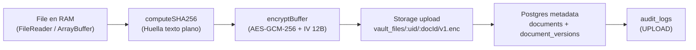
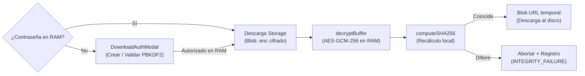

# INFINYX — Bóveda de Seguridad Zero-Knowledge

> Bóveda documental B2B con arquitectura estricta de **Conocimiento Cero (Zero-Knowledge)** y sistema de diseño **"Hexa-Mugen" con soporte dual nativo (Modo Oscuro "Seis Ojos" y Modo Claro "Blanco Titanio")** para sectores de alta exigencia: **Banca Privada, Family Offices, LegalTech, FinTech y Salud**. Ni el operador del servidor, ni el proveedor cloud, ni un atacante con acceso total a la infraestructura pueden leer los documentos: el texto plano jamás abandona la memoria RAM del cliente sin cifrar.


**Índice**

1. [Visión ejecutiva](#1-visión-ejecutiva)
2. [El problema y el modelo de amenazas (Threat Model)](#2-el-problema-y-el-modelo-de-amenazas-threat-model)
3. [Especificación criptográfica (`src/core/crypto/vaultCrypto.ts`)](#3-especificación-criptográfica-srccryptovaultcryptots)
4. [Arquitectura de software (Feature-Driven)](#4-arquitectura-de-software-feature-driven)
5. [Sistema de diseño "Hexa-Mugen" y Tema Dual (Oscuro / Claro)](#5-sistema-de-diseño-hexa-mugen-y-tema-dual-oscuro--claro)
6. [Arquitectura del backend (Supabase / PostgreSQL)](#6-arquitectura-del-backend-supabase--postgresql)
7. [Guía de instalación y despliegue local](#7-guía-de-instalación-y-despliegue-local)
8. [Operación segura, limitaciones conocidas y roadmap](#8-operación-segura-limitaciones-conocidas-y-roadmap)

---

## 1. Visión ejecutiva

**INFINYX** es una bóveda documental institucional donde el cifrado se realiza **íntegramente en el cliente**, antes de cualquier transmisión por red. El backend (Supabase: PostgreSQL + Storage + Auth) opera bajo el principio de **servidor ciego**: almacena únicamente blobs cifrados indistinguibles de ruido blanco, vectores de inicialización públicos y metadatos no sensibles (nombre, tamaño del texto plano, huella de integridad).

| Propiedad | Garantía |
|---|---|
<<<<<<< HEAD
| Confidencialidad | AES-GCM-256 con clave derivada localmente vía PBKDF2-SHA-256 (100.000 iteraciones). Credencial de autenticación derivada en cliente (`deriveAuthPassword`) para que Supabase Auth nunca reciba la passphrase cruda |
| Integridad | Triple capa: metadatos autenticados AES-GCM (AAD determinista) + tag GCM de 128 bits + verificación SHA-256 del texto plano tras descifrar |
| Aislamiento multitenant | Row Level Security (RLS) estricto por `auth.uid()` en todas las tablas y bucket privado por usuario |
| Custodia de claves | `CryptoKey` no extraíble (`extractable: false`), exclusivamente en memoria RAM (Zustand, sin persistencia) |
| Auto-Lock por inactividad | Cierre y bloqueo automático de la bóveda tras 10 minutos de inactividad, purgando `vaultKey` y la sesión de descarga de la memoria RAM |
| Contraseña de descarga | Compuerta de autorización por descarga/eliminación: verificador PBKDF2-SHA-256 (100.000 iteraciones) en `profiles`, contraseña en claro sólo en RAM (`useDownloadAuthStore`, sin `persist`), blindada contra bypass en el store |
| Acciones por archivo | 3 acciones directas: 1) "Descargar archivo" (gateada por contraseña en RAM), 2) "Visualizar" (modal centrado con metadatos y SHA-256) y 3) "Eliminar" (borrado seguro en Storage y base de datos) |
| Límite seguro en memoria | Validación preventiva de archivos vacíos (0 bytes) y límite máximo de 50 MB (`MAX_VAULT_FILE_SIZE_BYTES`) para evitar saturación de RAM en la pestaña |
| Recuperación soberana | Frase mnemónica de 12 palabras (diccionario oficial BIP-39, 2048 palabras), generada con `crypto.getRandomValues` tanto en registro directo como tras confirmación de OTP |
| Trazabilidad | Bitácora `audit_logs` con eventos `UPLOAD`, `DOWNLOAD_DECRYPT`, `INTEGRITY_FAILURE` y `DELETE` (FK `ON DELETE SET NULL` para preservar historial) |
| Cabeceras de seguridad | Content-Security-Policy (CSP) estricta y `Referrer-Policy: no-referrer` inyectadas en `index.html` para mitigar XSS y exfiltración de tokens |
| Cero dependencias cripto | 100 % Web Crypto API nativa. Prohibido `crypto-js`, `bcrypt` y cualquier librería de terceros para criptografía (ver `CLAUDE.MD`) |
=======
| **Confidencialidad** | AES-GCM-256 con clave derivada localmente vía PBKDF2-SHA-256 (100.000 iteraciones). El servidor nunca recibe passphrase, clave ni texto plano |
| **Integridad** | Doble capa: tag de autenticación AES-GCM (128 bits) + verificación SHA-256 del texto plano tras descifrar en cliente |
| **Aislamiento multitenant** | Row Level Security (RLS) estricto por `auth.uid()` en todas las tablas y bucket privado particionado por usuario |
| **Custodia de claves** | `CryptoKey` no extraíble (`extractable: false`), exclusivamente en memoria RAM (Zustand, sin middleware persistente) |
| **Contraseña de descarga** | Compuerta de autorización por descarga: verificador PBKDF2-SHA-256 (100.000 iteraciones) en `profiles`, contraseña en claro sólo en RAM (`useDownloadAuthStore`) |
| **Acciones por archivo** | 3 acciones de alto valor: 1) **Descargar archivo** (gateado por contraseña en RAM), 2) **Visualizar** (modal centrado y accesible con metadatos y copiado de huella) y 3) **Eliminar** (modal destructivo irreversible con autorización en RAM) |
| **Búsqueda y filtros en RAM** | Filtrado instantáneo 100 % en memoria del cliente por texto/hash, versión (`v1` / `v2+`) y ordenamiento sin peticiones extra |
| **Sistema visual Hexa-Mugen** | Isotipo de doble hexágono en titanio formando el infinito ($\infty$) con prisma central en paleta Azul Seis Ojos (`#BAE6FD`, `#38BDF8`, `#0284C7`) |
| **Soporte Dual de Tema** | **Modo Oscuro** (Obsidiana Abisal `#07090E` y Titanio `#0D111A`) y **Modo Claro** (Blanco Titanio `#FFFFFF` y Pizarra Limpia `#F8FAFC`), conmutables mediante `ThemeToggle` y persistidos en `localStorage` |
| **Recuperación soberana** | Frase mnemónica de 12 palabras (diccionario oficial BIP-39, 2048 palabras), generada con `crypto.getRandomValues` sin sesgo de módulo |
| **Trazabilidad** | Bitácora `audit_logs` con eventos `UPLOAD`, `DOWNLOAD_DECRYPT`, `DELETE` e `INTEGRITY_FAILURE` |
| **Cero dependencias cripto** | 100 % Web Crypto API nativa (`window.crypto.subtle`). Cero librerías externas para criptografía (sin crypto-js ni bcrypt) |
>>>>>>> dev

---

## 2. El problema y el modelo de amenazas (Threat Model)

### 2.1. Por qué las nubes tradicionales no bastan

En soluciones tradicionales de almacenamiento corporativo (Google Drive, OneDrive, AWS S3 SSE o Dropbox), **el proveedor retiene —directa o indirectamente— las claves de descifrado**:

- El cifrado "en reposo" lo aplica el servidor con claves que él mismo custodia (KMS del proveedor). Una orden judicial, un empleado desleal o una brecha con escalado de privilegios expone el contenido.
- El operador puede modificar políticas, rotar claves o acceder a snapshots sin conocimiento del cliente.
- Para un despacho jurídico, una entidad financiera o una firma de gestión patrimonial, esto incumple el principio de minimización de confianza exigido por RGPD, secreto bancario y normativas sectoriales (DORA, ENS, HIPAA).

### 2.2. Principio de Cero Confianza en el Servidor (Zero-Trust Backend)

INFINYX invierte el modelo: **el servidor es un disco duro ciego**.

- Supabase Storage (bucket privado `vault_files`) sólo recibe `ArrayBuffer` ya cifrados con AES-GCM-256, servidos como `application/octet-stream` con extensión `.enc`. Sin la clave, son indistinguibles de ruido blanco.
- PostgreSQL sólo guarda metadatos no sensibles: nombre de archivo, MIME, tamaño del texto plano, `storage_path`, IV (público por diseño en AES-GCM) y `sha256_hash` (sólo útil para verificar integridad *después* de descifrar, nunca para recuperar contenido).
- La autenticación (Supabase Auth) y la autorización (RLS) protegen el **acceso a los blobs**, pero incluso un atacante con `service_role`, con acceso físico a los discos o con un volcado completo de la base de datos **no puede descifrar ni un solo byte**: la clave sólo existe en la memoria RAM del navegador del usuario.

### 2.3. Actores y capacidades asumidas

| Atacante | Capacidad | Resultado esperado |
|---|---|---|
| **Curioso / empleado del proveedor** | Lectura total de Storage + Postgres | Obtiene ruido cifrado opaco. Sin clave: inútil |
| **Atacante de red (MITM)** | Interceptación TLS rota / CDN comprometido | Sólo ciphertext + metadatos públicos. La app exige contexto seguro (HTTPS) para Web Crypto |
| **Malware en el endpoint del usuario** | Lectura de RAM del navegador | Fuera de alcance: ningún software protege secretos en un endpoint comprometido; se mitiga con auto-bloqueo por inactividad (10 min) y destrucción inmediata de clave |
| **Usuario malicioso de otro tenant** | Llamadas autenticadas a la API | Bloqueado por RLS (`user_id = auth.uid()`) y rutas de Storage prefijadas por `{user_id}/` |
| **Manipulación del blob en servidor** | Sustitución o corrupción del `.enc` | Detectada: AES-GCM rechaza el tag de 128 bits y la verificación SHA-256 post-descifrado aborta la entrega, registrando `INTEGRITY_FAILURE` |

---

## 3. Especificación criptográfica (`src/core/crypto/vaultCrypto.ts`)

Todo el motor reside en un único módulo sin dependencias externas, basado exclusivamente en `window.crypto.subtle` y `window.crypto.getRandomValues`. Requiere **contexto seguro** (HTTPS o `localhost`).

### 3.1. Derivación de clave: PBKDF2-HMAC-SHA-256, 100.000 iteraciones

`deriveKey(passphrase, salt) → Promise<CryptoKey>`

1. La passphrase se importa como material base PBKDF2 (`importKey("raw", …, { name: "PBKDF2" }, false, ["deriveKey"])`).
2. Se deriva una clave simétrica `{ name: "AES-GCM", length: 256 }` con `iterations: 100_000` (recomendación OWASP) y hash `SHA-256`.
3. La `CryptoKey` resultante se crea con **`extractable: false`** y usos `["encrypt", "decrypt"]`: el material bruto de la clave no puede exportarse ni serializarse desde el proceso del navegador.

**Derivación del salt.** El salt PBKDF2 es determinista por usuario y se calcula en `deriveVaultSalt(userId)` como `SHA-256("tech-value:vault:kdf:v1:" + userId)`:
- Es único por cuenta (inmunidad frente a rainbow tables compartidas entre usuarios) y reproducible en cualquier dispositivo sin almacenar nada sensible.
<<<<<<< HEAD
- La etiqueta incluye dominio y versión (`tech-value:vault:kdf:v1`) para permitir migraciones futuras del KDF sin colisionar con claves existentes.
<<<<<<< HEAD
- > **Mejora recomendada (roadmap):** añadir `profiles.vault_salt text NOT NULL` con 32 bytes aleatorios generados en el registro y leerlo en lugar de derivarlo. Ver [sección 7](#7-operación-segura-limitaciones-conocidas-y-roadmap).
=======
- La etiqueta incluye dominio y versión para permitir migraciones futuras del KDF sin colisionar con claves existentes.
>>>>>>> dev

La misma passphrase cumplía dos funciones independientes: autenticación y derivación de la `vaultKey`. Con el endurecimiento de seguridad, **la passphrase original jamás se envía por la red en texto claro**:
=======
>>>>>>> dev

#### Derivación de la credencial de autenticación (`deriveAuthPassword`)

`deriveAuthPassword(email, passphrase) → Promise<string>`

<<<<<<< HEAD
- Deriva en el cliente una clave de 256 bits (`tv1_${hex}`) mediante `PBKDF2-SHA-256` con `100.000 iteraciones` y un dominio aislado:
  `salt = SHA-256("tech-value:auth:kdf:v1:" + email.trim().toLowerCase())`.
- Supabase Auth recibe esta credencial derivada como contraseña del usuario.
- **Retrocompatibilidad**: en `signIn` y `unlockVaultWithPassword`, si el primer intento con `deriveAuthPassword` no coincide, el cliente reintenta automáticamente con la contraseña legacy para no interrumpir el acceso a cuentas creadas antes de la actualización.
- La passphrase original del usuario se retiene exclusivamente en memoria RAM para derivar la `vaultKey`.

### 3.2. Cifrado simétrico autenticado con AAD: AES-GCM-256, IV de 12 bytes

`encryptBuffer(data, key, context?) → { cipherBuffer, iv }` / `decryptBuffer(cipherBuffer, key, ivString, context?)`

- **Metadatos Autenticados Adicionales (AAD):** `VaultEncryptionContext` `{ userId, documentId, versionNumber }` se inyecta en `additionalData` mediante `buildAdditionalData(ctx)`:
  `"tech-value:aad:v1:" + userId + ":" + documentId + ":v" + versionNumber`.
  Esto vincula matemáticamente el tag de autenticación de AES-GCM al propietario, documento y versión, impidiendo ataques de *rollback* de versiones o intercambio fraudulento de blobs en Supabase Storage.
- **Fallback retrocompatible en descifrado:** si un archivo fue subido antes de la inclusión de AAD (`v1.enc` legacy), `decryptBuffer` captura el fallo de autenticación de AAD y reintenta descifrar sin AAD, preservando la verificación posterior por SHA-256.
- Cada operación de cifrado genera un **IV aleatorio de 12 bytes (96 bits)** con `crypto.getRandomValues`, único por versión de documento, tal como exige AES-GCM. Reutilizar un IV con la misma clave sería catastrófico; aquí es imposible por construcción.
- El IV se serializa en hexadecimal y se almacena en claro en `document_versions.iv`. **El IV no es secreto** en AES-GCM: sólo garantiza unicidad.
- El descifrado valida la longitud del IV (12 bytes exactos) y delega en `subtle.decrypt`: si clave, IV o ciphertext no cuadran, la promesa se rechaza automáticamente gracias al **tag de autenticación de 128 bits** de GCM (primera capa de integridad).
- **Límite seguro de memoria:** se define `MAX_VAULT_FILE_SIZE_BYTES = 50 * 1024 * 1024` (50 MB). Se prohíben archivos vacíos (0 bytes) y archivos que superen los 50 MB antes de llamar a `file.arrayBuffer()` para evitar desbordar la memoria de la pestaña del navegador.
- Utilidades de serialización segura sin dependencias: `bufferToHex` / `hexToBuffer` (con validación estricta de formato), `bufferToBase64` / `base64ToBuffer` (por bloques de 32 KB para no desbordar la pila en archivos grandes).
=======
- Cada operación de cifrado genera un **IV aleatorio de 12 bytes (96 bits)** con `crypto.getRandomValues`, único por versión de documento, tal como exige la norma NIST SP 800-38D.
- El IV se serializa en hexadecimal y se almacena en claro en `document_versions.iv`. **El IV no es secreto** en AES-GCM: sólo garantiza unicidad.
- El descifrado valida la longitud del IV (12 bytes exactos) y delega en `subtle.decrypt`: si clave, IV o ciphertext no coinciden, la promesa se rechaza automáticamente mediante el **tag de autenticación de 128 bits** de GCM.
>>>>>>> dev

### 3.3. Integridad matemática: SHA-256 previo al cifrado

`computeSHA256(data) → hex` (minúsculas)

- En la subida se calcula el SHA-256 **del texto plano antes de cifrar** y se registra en `document_versions.sha256_hash` como referencia de integridad.
- En la descarga, tras descifrar en memoria RAM, se recalcula el hash del buffer resultante y se compara en tiempo constante. Cualquier discrepancia aborta la entrega al usuario y emite un evento `INTEGRITY_FAILURE` en auditoría.

### 3.4. Ciclo de vida de la clave en memoria RAM y Auto-Lock

```
Registro / Login
  → PBKDF2 local → CryptoKey (extractable: false)
    → useAuthStore.vaultKey (RAM, sin middleware persist)
<<<<<<< HEAD
      → uso en uploadDocument / downloadAndDecrypt (se pasa por parámetro;
         useVaultStore JAMÁS la almacena: la clave vive en un único lugar)
        → Auto-Lock (10 min inactividad) / signOut / SIGNED_OUT / recarga → null (destrucción inmediata)
```

- El store **no usa `persist` de Zustand**; la clave es no extraíble, por lo que ni siquiera *podría* serializarse a `localStorage`.
- **Auto-Lock por inactividad (10 minutos):** `src/App.tsx` vigila eventos de interacción del usuario (`mousemove`, `mousedown`, `keydown`, `touchstart`, `scroll` con `{ passive: true }`). Tras 10 minutos continuos sin actividad, invoca `lockVaultInMemory()`, `clearDownloadSessionPassword()` y el reseteo del catálogo. La sesión de Supabase Auth se mantiene intacta pero `vaultKey` es purgada de RAM, forzando al usuario a reintroducir su passphrase para continuar.
- `signOut()` destruye la clave **antes** de la llamada de red, minimizando la ventana de exposición.
- `initSession()` restaura la sesión de Supabase (sólo tokens, persistidos por el SDK), pero **nunca** la clave: tras recargar, la UI exige desbloquear de nuevo con la passphrase.
- En `localStorage` sólo viven los tokens de Supabase Auth (`persistSession: true`); robarlos permite descargar blobs, pero **siguen siendo ruido cifrado** sin la clave de bóveda.
=======
      → uso en uploadDocument / downloadAndDecrypt (pasada por parámetro)
        → Inactividad (10 min) / signOut / F5 → null (destrucción inmediata)
```

- El store **no usa `persist` de Zustand**; la clave no extraíble jamás toca `localStorage`, cookies ni IndexedDB.
- `signOut()` destruye la clave **antes** de la llamada de red.
- Temporizador de inactividad de 10 minutos en `App.tsx` que purga automáticamente la clave y la contraseña de descarga si no hay interacción del usuario.
>>>>>>> dev

### 3.5. Recuperación soberana: 12 palabras BIP-39 sin sesgo de módulo

`generateRecoveryPhrase() → string`

<<<<<<< HEAD
- En el registro se genera una frase de **12 palabras** del **diccionario oficial BIP-39 en inglés (2048 palabras)**, embebido en el módulo (fuente: `bitcoin/bips`).
- **Soporte integral en flujo OTP:** tanto en el registro directo como tras confirmar el código OTP de 6 dígitos (`verifySignUpOtp`), el sistema genera garantizadamente la frase mnemónica y la carga en memoria RAM (`recoveryPhrase`).
- Aleatoriedad de `crypto.getRandomValues` sobre `Uint16Array(12)`; como 2048 = 2¹¹, cada valor de 16 bits se enmascara a 11 bits (`& 0x07FF`). Dado que 65536 / 2048 = 32 exactamente, esta reducción **no introduce sesgo de módulo**: cada palabra tiene probabilidad idéntica.
- Es intencionalmente síncrona (no necesita `subtle`) y genera cada palabra de forma independiente: aquí actúa como **secreto de recuperación de bóveda**, no como semilla determinista de wallet, por lo que no se deriva entropía con checksum BIP-39 completo.
- La frase vive **sólo en RAM** (`recoveryPhrase`), se muestra una única vez con advertencia explícita ("el servidor no puede recuperarla") y debe limpiarse con `clearRecoveryPhrase()` en cuanto la UI termina de mostrarla. No existe columna para ella en base de datos, por diseño.
=======
- En el registro se genera una frase de **12 palabras** del **diccionario oficial BIP-39 (2048 palabras)** embebido en el módulo.
- Aleatoriedad provista por `crypto.getRandomValues` sobre `Uint16Array(12)`; al ser 2048 = 2¹¹, cada valor de 16 bits se enmascara a 11 bits (`& 0x07FF`), eliminando cualquier sesgo de módulo.
- La frase vive **sólo en RAM**, se muestra una única vez en el modal institucional y se purga tras confirmación.
>>>>>>> dev

### 3.6. Contraseña de descarga: verificador PBKDF2-SHA-256 + compuerta estricta en RAM

<<<<<<< HEAD
> Añadido en la iteración "Contraseña de Descarga en Memoria RAM" y blindado en el hardening de seguridad. Es una **compuerta de autorización** independiente de la `vaultKey`: el descifrado sigue usando AES-GCM-256; la contraseña de descarga sólo decide *si* se ejecuta la descarga o eliminación.

`generateDownloadSaltHex() → hex` / `deriveDownloadVerifier(password, saltHex) → hex` / `timingSafeEqualHex(a, b)` (en `vaultCrypto.ts`):

- **Creación:** salt aleatorio de 32 bytes (`crypto.getRandomValues`, 64 chars hex) + `PBKDF2-SHA-256, 100.000 iteraciones, 256 bits` vía `subtle.deriveBits` (no `deriveKey`: aquí sí se necesita comparar el material derivado). Se persisten **sólo** `profiles.download_salt` y `profiles.download_verifier` (ambos hex públicos por diseño; el salt no es secreto, el verificador no permite recuperar la contraseña).
- **Verificación:** se re-deriva con el salt guardado y se compara con el verificador en **tiempo constante** (`timingSafeEqualHex`) para no filtrar por timing la posición del primer byte distinto.
- **Custodia:** la contraseña en claro vive **únicamente** en `useDownloadAuthStore.downloadSessionPassword` (Zustand **sin** middleware `persist`: jamás toca `localStorage`, `sessionStorage`, cookies ni IndexedDB). Al recargar la pestaña vuelve a `null` automáticamente (el módulo se re-evalúa); al cerrar sesión o por Auto-Lock, se destruye con `clearDownloadSessionPassword()`.
- **Blindaje contra bypass en el Store:** tanto `downloadAndDecrypt` como `deleteDocument` en `useVaultStore` verifican preventivamente `useDownloadAuthStore.getState().hasDownloadSessionPassword()`. Ninguna invocación directa desde consola o componentes externos puede descargar o borrar archivos si la contraseña en RAM no ha sido provista.
- A diferencia del salt determinista de la `vaultKey` (derivado del `userId` por limitación del esquema original), este salt **sí es aleatorio por usuario** y migra el diseño hacia el objetivo del roadmap (`profiles.vault_salt`).
=======
`generateDownloadSaltHex()` / `deriveDownloadVerifier(password, saltHex)` / `timingSafeEqualHex(a, b)`:

- **Creación:** Salt aleatorio de 32 bytes (64 caracteres hex) + `PBKDF2-SHA-256, 100.000 iteraciones, 256 bits` vía `subtle.deriveBits`. Se persisten en `profiles.download_salt` y `profiles.download_verifier`.
- **Verificación:** Derivación del candidato y comparación en tiempo constante (`timingSafeEqualHex`) para mitigar ataques de temporización.
- **Custodia:** La contraseña validada vive únicamente en `useDownloadAuthStore.downloadSessionPassword` en RAM durante la pestaña activa.
>>>>>>> dev

---

## 4. Arquitectura de software (Feature-Driven)

### 4.1. Árbol de directorios

```
src/
<<<<<<< HEAD
├── main.tsx                      # Entrypoint: StrictMode + App
<<<<<<< HEAD
├── index.css                     # Directivas Tailwind (base/components/utilities)
├── vite-env.d.ts                 # Tipado de VITE_SUPABASE_URL / VITE_SUPABASE_ANON_KEY
├── App.tsx                       # Puerta de estados: initSession + Auto-Lock (10 min inactividad)
├── app/                          # (reservado) router, providers y layout raíz
├── assets/                       # Estáticos del template Vite
│
├── core/crypto/
│   └── vaultCrypto.ts            # Motor Zero-Knowledge: PBKDF2, AES-GCM-256 con AAD,
│                                 # deriveAuthPassword, SHA-256, frase BIP-39, límites de RAM
│
├── features/auth/
│   ├── components/AuthCard.tsx   # Login/registro con pestañas + verificación OTP de 6 dígitos
│   └── stores/useAuthStore.ts    # Sesión Supabase + vaultKey en RAM + recoveryPhrase + lockVaultInMemory
│
├── features/vault/
│   ├── components/
│   │   ├── VaultDashboard.tsx       # Header corporativo + catálogo de documentos + modales
│   │   ├── DocumentRow.tsx          # Fila con 3 acciones: Descargar archivo + Visualizar + Eliminar
│   │   ├── DocumentPreviewModal.tsx # Modal centrado para visualizar metadatos, SHA-256 completa y versión
│   │   ├── DeleteDocumentModal.tsx  # Modal de confirmación destructiva y autorización con contraseña en RAM
│   │   ├── DownloadAuthModal.tsx    # Configurar / ingresar contraseña de descarga (PBKDF2 en RAM)
│   │   └── FileUploadModal.tsx      # Drag & Drop + validación 50 MB + pipeline visual con AAD
│   └── stores/
│       ├── useVaultStore.ts         # Catálogo + subida/descarga/borrado con AAD + compuerta en RAM
│       └── useDownloadAuthStore.ts  # downloadSessionPassword SÓLO en RAM, sin persist
│
├── features/audit/               # (reservado) UI de auditoría; el registro lo emite useVaultStore
=======
├── index.css                     # Directivas Tailwind + capa base Private Wealth (.font-editorial)
=======
├── main.tsx                      # Entrypoint: StrictMode + inicialización de tema + App
├── index.css                     # Directivas Tailwind + estilos base Dark/Light mode
>>>>>>> dev
├── vite-env.d.ts                 # Tipado de VITE_SUPABASE_URL / VITE_SUPABASE_ANON_KEY
├── App.tsx                       # Orquestador: timeout inactividad (10m) + compuerta de estados
├── app/                          # Layout y proveedores base
├── assets/                       # Recursos estáticos
│
├── core/crypto/
│   └── vaultCrypto.ts            # Motor Zero-Knowledge puro: PBKDF2, AES-GCM-256,
│                                 # SHA-256, BIP-39, comparador timing-safe, utilidades hex
│
├── features/auth/
│   ├── components/
│   │   └── AuthCard.tsx          # Login, Registro, OTP y Frase BIP-39 con ThemeToggle
│   └── stores/
│       └── useAuthStore.ts       # Sesión Supabase + vaultKey en RAM + recoveryPhrase efímera
│
├── features/vault/
│   ├── components/
│   │   ├── VaultDashboard.tsx    # Header INFINYX, catálogo de custodia, ThemeToggle y filtros
│   │   ├── DocumentRow.tsx       # Fila adaptada con badges de versión y 3 acciones directas
│   │   ├── FileUploadModal.tsx   # Modal drag & drop con barra minimalista de cifrado
│   │   ├── DocumentPreviewModal.tsx # Modal centrado en portal: metadatos y copiado de SHA-256
│   │   ├── DownloadAuthModal.tsx # Compuerta de autorización para contraseña en RAM
│   │   └── DeleteDocumentModal.tsx  # Confirmación destructiva con autorización en RAM
│   ├── stores/
│   │   ├── useVaultStore.ts      # Catálogo + subida/descifrado + bitácora audit_logs
│   │   └── useDownloadAuthStore.ts # Contraseña de descarga en RAM (sin persist)
│   └── utils/
│       └── formatters.ts         # Formateadores institucionales (tamaño, fechas, hashes)
>>>>>>> dev
│
└── shared/
    ├── components/
    │   ├── HexaMugenLogo.tsx     # Isotipo vectorial de doble hexágono en titanio y Seis Ojos
    │   └── ThemeToggle.tsx       # Conmutador interactivo Sol / Luna (Modo Claro / Oscuro)
    ├── stores/
    │   └── useThemeStore.ts      # Gestor de tema con persistencia en localStorage
    ├── lib/
    │   └── supabase.ts           # Cliente tipado createClient<Database>
    └── types/
<<<<<<< HEAD
        ├── database.ts           # Contrato del esquema public + VAULT_BUCKET = 'vault_files'
        └── index.ts              # VaultDocument, VaultVersionDescriptor, UploadStatus, AuditAction

supabase/
└── migrations/
    └── 20261019_security_hardening.sql  # Hardening RLS (DELETE), FK audit_logs y trigger protect_profile
```

| Módulo | Responsabilidad | Lo que nunca hace |
|---|---|---|
| `core/crypto` | Primitivas puras, testeables, sin I/O ni estado | Tocar red, DOM o stores |
| `features/auth` | Identidad + custodia en RAM de `vaultKey` y `recoveryPhrase` | Persistir la clave; almacenarla fuera de RAM |
| `features/vault` | Orquestar el pipeline cifrado, catálogo y borrado seguro; recibir la clave **por parámetro** | Almacenar la `vaultKey` (vive en un único lugar) |
| `shared` | Cliente Supabase tipado y tipos de dominio derivados del esquema real | Contener lógica de negocio |

La UI (`src/App.tsx`) implementa un flujo unificado con un único inicio de sesión: si no hay sesión activa o la clave de bóveda no reside en memoria RAM (`vaultKey === null`, p. ej. tras recargar F5, cerrar sesión o dispararse el Auto-Lock por 10 minutos de inactividad), se renderiza la pantalla principal de autenticación (`AuthCard`). Una vez autenticado y derivada la `vaultKey` en RAM, se accede directamente a `VaultDashboard`.

### 4.2. Flujo de datos: subida

Paso a paso (`uploadDocument(file, vaultKey)` en `useVaultStore.ts`):

1. **Validación preventiva de límites:** comprobación de archivo vacío (`0 bytes`) y límite máximo seguro de 50 MB (`MAX_VAULT_FILE_SIZE_BYTES`) antes de asignar buffers en RAM o consultar la base de datos.
2. **Lectura local** (`uploadStatus: 'reading'`): `file.arrayBuffer()` en memoria; el texto plano nunca toca disco ni red.
3. **Huella de integridad** (`'hashing'`): `computeSHA256` del texto plano → referencia matemática de integridad.
4. **Cifrado con metadatos autenticados (AAD)** (`'encrypting'`): `encryptBuffer` con la `vaultKey` de RAM, IV aleatorio e inyección de `VaultEncryptionContext` `{ userId, documentId, versionNumber }`.
5. **Transmisión opaca** (`'uploading'`): subida del ciphertext a `{user_id}/{document_id}/v{version}.enc` (soporte versionado hasta 3 versiones: `v1`, `v2`, `v3`).
6. **Registro transaccional**: `insert` en `documents` + `document_versions` (con `iv`, `sha256_hash` y `file_size`). Si falla el registro, se ejecuta rollback automático del objeto en Storage y compensación en base de datos.
7. **Auditoría no bloqueante** (`UPLOAD`): registro de auditoría con metadatos y tamaños.
8. `uploadStatus: 'done'` y refresco del catálogo vía `fetchDocuments()`.

### 4.3. Flujo de datos: descarga (gateada por la contraseña en RAM)

Paso a paso (`VaultDashboard.handleDownload` + `downloadAndDecrypt(descriptor, vaultKey)`):

1. **Compuerta de autorización en RAM:** tanto a nivel de UI como de Store (`useVaultStore`), se exige obligatoriamente que `useDownloadAuthStore.downloadSessionPassword` esté en RAM. Si no lo está, la operación se bloquea y se abre `DownloadAuthModal`.
2. Descarga del blob cifrado desde `versionData.storagePath`.
3. Descifrado en RAM con verificación de AAD (`decryptBuffer` con `context`); AES-GCM rechaza automáticamente claves incorrectas, ciphertext manipulado o metadatos inconsistentes (con fallback retrocompatible para versiones legacy sin AAD).
4. Verificación SHA-256 contra `document_versions.sha256_hash`. Ante discrepancia: evento `INTEGRITY_FAILURE` y error explícito al usuario.
5. Evento `DOWNLOAD_DECRYPT` y entrega al disco mediante `<a download>` con object URL revocada a los 60 s (`OBJECT_URL_TTL_MS`).

### 4.4. Acciones por archivo: 3 acciones seguras

`DocumentRow.tsx` expone 3 opciones en la columna de acciones:

| # | Acción | Disparador | Efecto |
|---|---|---|---|
| 1 | **Descargar archivo** | Botón con icono `Download` | Ejecuta el flujo gateado de [4.3](#43-flujo-de-datos-descarga-gateada-por-la-contraseña-en-ram) |
| 2 | **Visualizar** | Botón con icono `Eye` | Abre el modal centrado `DocumentPreviewModal` (portal fuera de la tabla) con tipo MIME, huella SHA-256 completa (con botón copiar), tamaño formateado, versión actual y fecha de custodia |
| 3 | **Eliminar** | Botón con icono `Trash` | Abre `DeleteDocumentModal`: requiere confirmación explícita y autorización con contraseña en RAM. Purga todos los blobs `.enc` de Supabase Storage, elimina registros en `documents` y `document_versions` en cascada y asienta evento `DELETE` en `audit_logs` |

### 4.5. Endurecimiento propuesto: modo Solo Depósito (roadmap)

> **Estado: propuesta de diseño, no implementado.** El catálogo actual permite a cada propietario subir y descargar sus propios documentos. Para escenarios de custodia receptora (p. ej. un notario que recibe pruebas de clientes sin que estos puedan leer ni borrar lo ajeno), el diseño prevé un **modo Solo Depósito**: otorgar a un rol/sesión básica permiso de `INSERT` en `documents`/`document_versions` y de subida al prefijo de Storage correspondiente, **denegando** `SELECT` sobre versiones ajenas, `DOWNLOAD` de blobs y `DELETE`. Se implementa íntegramente con políticas RLS y de Storage (sin cambios de cliente), siguiendo el patrón de la [sección 5.3](#53-row-level-security-referencia). Consta como trabajo futuro en la [sección 7](#7-operación-segura-limitaciones-conocidas-y-roadmap).
=======
        ├── database.ts           # Esquema relacional de Supabase (PostgreSQL)
        └── index.ts              # Tipos de dominio: VaultDocument, UploadStatus, AuditAction
```

### 4.2. Flujo de datos: Subida Cifrada



1. **Lectura local**: Carga directa del archivo en memoria RAM del navegador.
2. **Huella criptográfica**: Cálculo SHA-256 del texto plano como sello de integridad.
3. **Cifrado autenticado**: Cifrado local con la `vaultKey` AES-GCM e IV único por versión.
4. **Almacenamiento ciego**: Transmisión a Supabase Storage con extensión `.enc` y tipo `application/octet-stream`.
5. **Registro de versión**: Escritura atómica de metadatos no sensibles (`iv`, `sha256_hash`, `file_size`).
6. **Compensación ante fallos**: Rollback automático en Storage si el registro relacional falla.

### 4.3. Flujo de datos: Descarga con Compuerta de Autorización


>>>>>>> dev

---

## 5. Sistema de diseño "Hexa-Mugen" y Tema Dual (Oscuro / Claro)

El sistema de diseño **"Hexa-Mugen"** de **INFINYX** combina precisión geométrica con la paleta de energía Azul *"Seis Ojos"* (*Six Eyes*), ofreciendo dos estilos visuales completos:

1. **Modo Oscuro (*Obsidiana Abisal*)**: Profundidad cibernética en `#07090E`, tarjetas en titanio oscuro `#0D111A` y delineados energéticos luminosos.
2. **Modo Claro (*Blanco Titanio / Cristalino*)**: Lienzo blanco de pizarra suave `#F8FAFC`, tarjetas en porcelana técnica `#FFFFFF`, bordes sutiles de acero `#E2E8F0` y tipografía de alto contraste `#0F172A`.

### 5.1. Matriz de tokens y paleta de colores

| Token / Elemento | Modo Oscuro (*Dark*) | Modo Claro (*Light*) | Aplicación / Rol |
| :--- | :--- | :--- | :--- |
| **Fondo Principal** | `#07090E` | `#F8FAFC` | Fondo de `body`, pantalla de inicio y dashboard |
| **Tarjetas y Modales** | `#0D111A` / `#111827` | `#FFFFFF` | Superficie principal de contenido y ventanas modales |
| **Cabeceras de Tabla / Paneles** | `#0A0E17` | `#F8FAFC` / `#F1F5F9` | Cabecera `<thead>`, cajas de código y avisos |
| **Bordes de Contenedores** | `#1E293B` | `#E2E8F0` | Líneas de división y contornos de tarjeta |
| **Texto Principal** | `#F8FAFC` | `#0F172A` | Títulos, nombres de documentos y valores clave |
| **Texto Secundario** | `#94A3B8` | `#64748B` | Metadatos, fechas, tamaños y hashes |
| **Azul Seis Ojos (Acento)** | `#38BDF8` (`sky-400`) | `#0284C7` (`sky-600`) | Iconos de acento, bordes activos y checkboxes |
| **Núcleo Cristalino (Highlight)** | `#BAE6FD` (`sky-200`) | `#0369A1` (`sky-700`) | Punto focal del logo y texto de versión (`v1`, `v2+`) |
| **Gradiente Primario (CTA)** | `from-[#0284C7] via-[#0EA5E9] to-[#38BDF8]` | `from-[#0284C7] via-[#0EA5E9] to-[#38BDF8]` | Botones principales de acción (+ Proteger documento, Desbloquear) |

### 5.2. Selector de Tema (`ThemeToggle`) y Persistencia

- Gobernado por `useThemeStore.ts` y la clase `.dark` en `document.documentElement` (`darkMode: 'class'` en Tailwind).
- La preferencia se almacena en `localStorage.getItem('infinyx-theme')`, preservándose entre sesiones y recargas de pestaña.
- El conmutador se encuentra disponible tanto en la pantalla de autenticación (`AuthCard`) como en la cabecera principal (`VaultDashboard`).

### 5.3. Isotipo Vectorial Hexa-Mugen (`HexaMugenLogo.tsx`)

El isotipo representa la convergencia del infinito ($\infty$) mediante una estructura hexagonal facetada de titanio angulado con doble delineado y un prisma central flotante encendido con gradiente Azul Seis Ojos (`#BAE6FD` → `#38BDF8` → `#0284C7`). Su relleno se adapta automáticamente (`fill-white dark:fill-[#0D111A]`) para lucir impecable en ambos temas.

### 5.4. Barra de Progreso Minimalista en Cifrado

El modal de subida de archivos (`FileUploadModal.tsx`) incorpora una barra de progreso limpia y compacta con cálculo de porcentaje dinámico (`0%`, `25%`, `50%`, `75%`, `100%`) y estado reactivo (*"Cifrando archivo…"*, *"Archivo cifrado y protegido"*, *"Error al procesar el archivo"*), eliminando tarjetas redundantes.

---

## 6. Arquitectura del backend (Supabase / PostgreSQL)

Esquema `public` auditado y tipado en `src/shared/types/database.ts`:

### 6.1. Tablas relacionales

- **`profiles`**: Almacena el identificador `id uuid` (`auth.users.id`), `email`, y las columnas criptográficas de autorización:
  - `download_verifier text`: Hash derivado PBKDF2-SHA-256 (100.000 iteraciones) de la contraseña de descarga.
  - `download_salt text`: Salt criptográfico aleatorio de 32 bytes (hex).
- **`documents`**: Cabecera lógica de documentos vinculada a `user_id uuid`.
- **`document_versions`**: Versiones inmutables con `iv` (12 bytes hex), `sha256_hash` (hex del texto plano) y `storage_path`.
- **`audit_logs`**: Registro inmutable de eventos (`UPLOAD`, `DOWNLOAD_DECRYPT`, `DELETE`, `INTEGRITY_FAILURE`).

### 6.2. Row Level Security (RLS)

Políticas de seguridad a nivel de fila obligatorias:

```sql
<<<<<<< HEAD
-- Migración requerida para la contraseña de descarga:
alter table profiles
  add column if not exists download_verifier text,
  add column if not exists download_salt text;
```

**`documents`** — documento lógico (cabecera). `id uuid PK` (generado en cliente), `user_id uuid`, `name text`, `mime_type text` (tipo real para la descarga; el blob viaja como opaco), `created_at` / `updated_at`. Listado ordenado por `updated_at` descendente.

**`document_versions`** — versiones inmutables, una por blob. `id uuid PK`, `document_id FK → documents.id`, `version_number int4` (la primera subida es `v1`), `storage_path text` (`{user_id}/{document_id}/vN.enc`), **`sha256_hash` (hex del texto plano)**, **`iv` (hex, 12 bytes, único por versión)**, `file_size int8` (tamaño del texto plano, el que ve la UI), `created_at`. La UI resuelve la versión con mayor `version_number` como `latestVersion` (`VaultDocument`).

**`audit_logs`** — bitácora append-only. `id uuid PK`, `user_id`, `document_id` (nulables para no perder eventos huérfanos), `action text` (unión cerrada en cliente: `UPLOAD | DOWNLOAD_DECRYPT | INTEGRITY_FAILURE | DELETE`), `details jsonb`, `created_at`. El cliente la escribe en modo best-effort (ver 4.2); para auditoría no repudiable se recomienda replicar con un trigger `AFTER INSERT` sobre `document_versions` en Postgres.

### 5.2. Storage: bucket privado `vault_files`

- Objetos en `{user_id}/{document_id}/v{version}.enc`, `contentType: application/octet-stream`, `upsert: false` (las versiones son inmutables; jamás se sobrescriben).
- El `mime_type` real viaja sólo en `documents` para reconstruir la descarga; el objeto almacenado es opaco y no filtra el tipo de contenido.

### 5.3. Row Level Security y Migraciones SQL

El repositorio versiona la migración oficial de seguridad en [`supabase/migrations/20261019_security_hardening.sql`](file:///home/gabi/Escritorio/PROYECTO/tech-value/supabase/migrations/20261019_security_hardening.sql). A continuación se resumen las políticas canónicas de referencia coherentes con el acceso del cliente:

```sql
-- Aislamiento multitenant estricto por auth.uid()
alter table profiles           enable row level security;
alter table documents          enable row level security;
alter table document_versions  enable row level security;
alter table audit_logs         enable row level security;
=======
alter table profiles          enable row level security;
alter table documents         enable row level security;
alter table document_versions enable row level security;
alter table audit_logs        enable row level security;
>>>>>>> dev

-- Aislamiento estricto por auth.uid()
create policy "profiles_owner"
  on profiles for all using (id = auth.uid()) with check (id = auth.uid());

create policy "documents_owner"
  on documents for all using (user_id = auth.uid()) with check (user_id = auth.uid());

create policy "versions_owner_select"
  on document_versions for select using (
<<<<<<< HEAD
    exists (select 1 from documents d
            where d.id = document_versions.document_id
              and d.user_id = auth.uid())
=======
    exists (select 1 from documents d where d.id = document_versions.document_id and d.user_id = auth.uid())
>>>>>>> dev
  );

create policy "versions_owner_write"
  on document_versions for insert with check (
<<<<<<< HEAD
    exists (select 1 from documents d
            where d.id = document_versions.document_id
              and d.user_id = auth.uid())
  );

-- Política de eliminación segura para versiones
create policy "versions_owner_delete"
  on document_versions for delete using (
    exists (select 1 from documents d
            where d.id = document_versions.document_id
              and d.user_id = auth.uid())
  );

-- Auditoría append-only: el dueño inserta y lee lo suyo; nadie actualiza ni borra
=======
    exists (select 1 from documents d where d.id = document_versions.document_id and d.user_id = auth.uid())
  );

>>>>>>> dev
create policy "audit_owner_insert"
  on audit_logs for insert with check (user_id = auth.uid());

create policy "audit_owner_select"
  on audit_logs for select using (user_id = auth.uid());
```

<<<<<<< HEAD
```sql
-- Storage: cada usuario, sólo dentro de su prefijo {user_id}/
create policy "vault_files_owner"
  on storage.objects for all
  using (bucket_id = 'vault_files' and (storage.foldername(name))[1] = auth.uid()::text)
  with check (bucket_id = 'vault_files' and (storage.foldername(name))[1] = auth.uid()::text);
```

### 5.4. Endurecimiento de Seguridad en Base de Datos (`20261019_security_hardening.sql`)

El script SQL en `supabase/migrations/20261019_security_hardening.sql` aplica tres defensas críticas a nivel de motor PostgreSQL:

1. **Clave foránea no bloqueante en auditoría:** ajusta `audit_logs.document_id` a `ON DELETE SET NULL`, de modo que borrar un documento no sea bloqueado por el histórico y preserve la trazabilidad forense inmutable.
2. **Política RLS `DELETE` en `document_versions`:** autoriza al propietario del documento matriz a borrar sus versiones asociadas.
3. **Trigger de inmutabilidad en perfiles (`protect_profile_security_fields`):**
   ```sql
   create trigger trg_protect_profile_security_fields
     before update on public.profiles
     for each row
     execute function public.protect_profile_security_fields();
   ```
   Impide que un atacante con sesión temporal secuestrada modifique el `id` o sobrescriba/blanquee el `download_verifier` y `download_salt` una vez configurados.

=======
>>>>>>> dev
---

## 7. Guía de instalación y despliegue local

### 7.1. Requisitos

- **Node.js 20 LTS o 22+**
- **pnpm 9+**
- Proyecto Supabase configurado con el bucket privado `vault_files`.

### 7.2. Puesta en marcha

```bash
# 1. Clonar el repositorio
git clone <url-del-repo> infinyx-vault
cd infinyx-vault

# 2. Instalar dependencias exactas
pnpm install

# 3. Configurar variables de entorno
cp .env.example .env.local # O crear .env.local
```

Configuración en `.env.local`:

```bash
VITE_SUPABASE_URL=https://tu-proyecto.supabase.co
VITE_SUPABASE_ANON_KEY=tu-anon-key-publica
```

### 7.3. Comandos de desarrollo y auditoría

| Comando | Descripción |
|---|---|
<<<<<<< HEAD
| `pnpm run dev` | Servidor de desarrollo Vite con HMR |
| `pnpm run build` | Verificación estricta `tsc -b` + build de producción (`dist/`) |
| `pnpm run preview` | Sirve `dist/` en local para validar el artefacto |
| `pnpm run lint` | `oxlint` (reglas React + TypeScript, `rules-of-hooks` como error) |

El proyecto compila en modo estricto: `strict`, `noUncheckedIndexedAccess`, `noUnusedLocals`, `noUnusedParameters`, `verbatimModuleSyntax` y `erasableSyntaxOnly` (TypeScript 6.0, target ES2023).

### 6.5. Puesta en marcha del backend (checklist)

1. Crear el proyecto en Supabase y anotar URL + `anon key`.
2. Crear las tablas `profiles`, `documents`, `document_versions`, `audit_logs` según [5.1](#51-tablas) (tipos exactos en `src/shared/types/database.ts`).
3. Aplicar las políticas RLS y de Storage de [5.3](#53-row-level-security-y-migraciones-sql).
4. Ejecutar la migración de endurecimiento de seguridad [`supabase/migrations/20261019_security_hardening.sql`](file:///home/gabi/Escritorio/PROYECTO/tech-value/supabase/migrations/20261019_security_hardening.sql) en el SQL Editor de Supabase (RLS DELETE, FK `audit_logs` y trigger protector de `profiles`).
5. Crear el bucket privado `vault_files`.
6. Configurar `.env.local`, ejecutar `pnpm run dev`, registrar una cuenta y subir el primer documento: el modal mostrará el pipeline `reading → hashing → encrypting → uploading → done`.
7. Pulsar "Descargar archivo": la primera vez se abre `DownloadAuthModal` para crear la contraseña de descarga; las siguientes descargas de la misma pestaña son directas (vive en RAM).
=======
| `pnpm run dev` | Inicia el servidor de desarrollo Vite con HMR |
| `pnpm run lint` | Ejecuta `oxlint` (validación estricta de TypeScript y reglas React) |
| `pnpm run build` | Compilación estricta con `tsc -b` y empaquetado optimizado en `dist/` |
| `pnpm run preview` | Sirve localmente la compilación de producción para validación |
>>>>>>> dev

---

## 8. Operación segura, limitaciones conocidas y roadmap

### 8.1. Buenas prácticas operativas

<<<<<<< HEAD
- Servir siempre bajo HTTPS: sin contexto seguro, `crypto.subtle` no existe y el módulo criptográfico debe negarse a operar.
- El cierre de sesión y el Auto-Lock por inactividad (10 min) destruyen la clave **y** la contraseña de descarga en RAM de inmediato; la expiración o revocación de sesión (`SIGNED_OUT`) hace lo mismo. Tras recargar la pestaña o bloquearse, reintroducir la passphrase es obligatorio y la contraseña de descarga vuelve a `null` (se solicita una vez por sesión activa).
- La auditoría del lado cliente es best-effort por diseño (nunca invalida una operación consolidada); la fuente no repudiable debe ser un trigger en Postgres.
- Los blobs huérfanos se compensan automáticamente (rollback en Storage y borrado de la fila de documento sin versiones).
=======
- **Contexto seguro obligatorio**: Servir bajo HTTPS en entornos de producción para habilitar `window.crypto.subtle`.
- **Inactividad**: La aplicación expira automáticamente la clave en RAM a los 10 minutos de inactividad del cursor o teclado.
- **Sin huella persistente**: Al cerrar sesión o recargar con F5, la memoria RAM es liberada y la clave de cifrado se destruye por completo.
>>>>>>> dev

### 8.2. Roadmap y evolución

<<<<<<< HEAD
- El salt PBKDF2 de la `vaultKey` es determinista por usuario (derivado del `userId`), no aleatorio por bóveda: conserva unicidad por cuenta pero pierde aleatoriedad por bóveda. Migración prevista a `profiles.vault_salt` con 32 bytes aleatorios. (El verificador de la contraseña de descarga **sí** usa ya salt aleatorio de 32 bytes.)
- La frase de recuperación es un secreto de un solo uso mostrado una vez (tanto en registro directo como en verificación OTP): si el usuario la pierde y olvida su passphrase, **los documentos son irrecuperables por diseño** (no existe "restablecer contraseña" que preserve el acceso: una passphrase nueva deriva una clave distinta).
- La contraseña de descarga no tiene flujo de "olvido/recuperación": si se pierde, no hay verificador alternativo; requiere rotación manual (nuevo `update` de `download_verifier`/`download_salt`). Está pendiente una pantalla de rotación explícita.
- El historial de versiones soporta hasta 3 versiones secuenciales activas (`v1`..`v3`); la restauración de versiones previas como activas y el visor de auditoría en `features/audit` están en el roadmap.

**Roadmap**

1. `profiles.vault_salt` aleatorio + versionado del KDF (aumentar iteraciones PBKDF2 / migrar a Argon2id vía componente dedicado cuando Web Crypto lo estandarice).
2. Interfaz para visualización de historial de versiones previas (`v1`..`v3`) y restauración.
3. Modo Solo Depósito (ver [4.5](#45-endurecimiento-propuesto-modo-solo-depósito-roadmap)).
4. Trigger `AFTER INSERT` en `document_versions` para auditoría servidora no repudiable.
5. Compartición entre tenants mediante cifrado híbrido (clave de documento envuelta con la clave pública del receptor; el servidor sigue ciego).
=======
1. **Rotación soberana de claves**: Re-cifrado en lote de versiones mediante derivación progresiva sin exposición en servidor.
2. **Historial de versiones completas**: Interfaz para restaurar versiones intermedias (`v1`, `v2`, `v3`) directamente en el modal de previsualización.
3. **Modo Solo Depósito**: Capacidad de recepción documental para terceros sin privilegios de lectura o eliminación.
4. **Triggers PostgreSQL**: Auditoría formal irrevocable mediante triggers automáticos en la base de datos.
>>>>>>> dev
